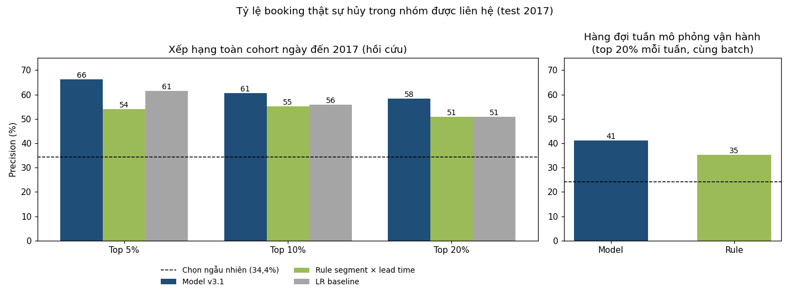
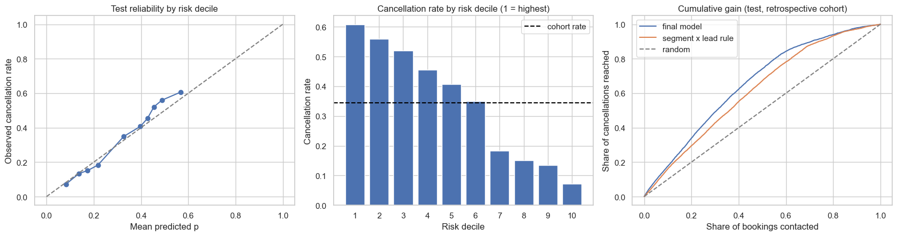
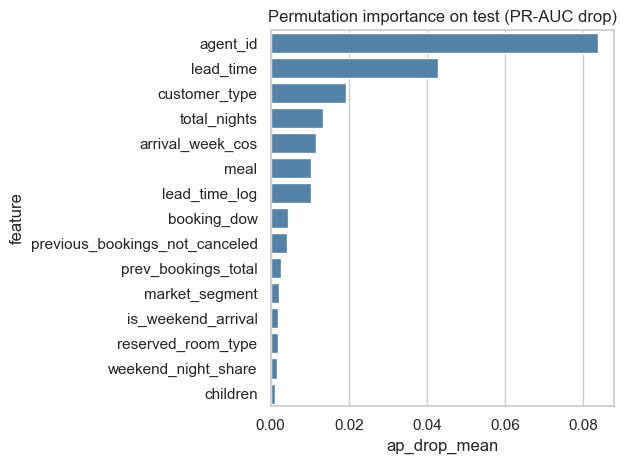
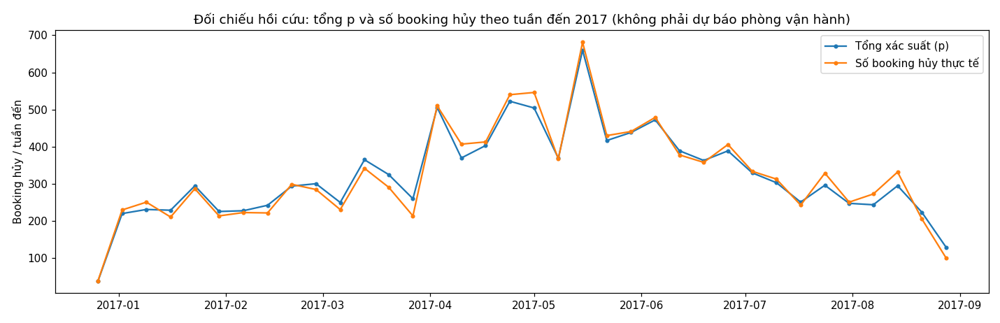

# Báo cáo giai đoạn F (F1–F3): Mô hình dự báo hủy phòng và kết nối với quyết định kinh doanh

*City Hotel, Lisbon · Nhóm 2 · Advanced Business Analytics · 19/10/2026. Nguồn số liệu: `notebooks/04_modeling_evaluation.ipynb` (v3.1, model version `f-v3.1-2026-10-19`, run `f-v3.1-2026-10-19_20261019-170452`). Mọi bảng đều có CSV tương ứng trong `artifacts/modeling/`. Bản v3.1 sửa các mục Fv3-01…14 của báo cáo chạy lại từ đầu bản v3; mô hình, fold, tuning và xác suất dự báo không đổi (chênh lệch tối đa 0,0 so với v3).*

---

## 0. Tóm tắt điều hành

- **Bài toán:** City Hotel có tỷ lệ hủy 41,7%. Giai đoạn F xây dựng điểm rủi ro hủy cho từng booking, đánh giá trung thực theo thời gian và nối điểm đó với hành động của khách sạn.
- **Cách tiếp cận hai lớp:**
  - **Khách lẻ** (individual, 52.676 booking): model XGBoost, chỉ dùng các biến thuộc thời điểm đặt phòng (giá trị vẫn lấy từ snapshot).
  - **Đoàn/lô** (group_block, 26.216 booking): rule theo tỷ lệ hủy lịch sử. Tỷ lệ hủy cao chủ yếu đến từ đặt cọc Non Refund.
- **Hai góc nhìn, không trộn lẫn:**
  1. **Đánh giá hồi cứu theo cohort ngày đến 2017** (chỉ để đánh giá model).
  2. **Mô phỏng hàng đợi vận hành theo tuần:** booking được chấm vào **cuối tuần đặt phòng**, bằng model đã fit và chọn xong trước thời điểm đó, và chỉ khi còn đủ điều kiện (chưa hủy, chưa đến, không phải complimentary). `risk_scores.csv`, tier, hành động và tải việc chỉ lấy từ góc nhìn này.
- **Kết quả hồi cứu trên cohort 2017** (holdout đã được khám phá một phần):
  - **Khách lẻ:** AUC 0,736 · average precision ("PR-AUC") 0,556 (nền 0,344) · Brier 0,192 (hằng số 0,230).
  - **Top 20% toàn cohort:** 58,3% thật sự hủy (lift 1,70). Xếp theo tổn thất kỳ vọng, nhóm này chứa **52% doanh thu bị hủy**.
  - **So với rule segment × lead time, cùng top 20% cohort:** thêm **308 ca hủy được phát hiện**; khác biệt có ý nghĩa ở 5%, 10% và 20% (bootstrap ghép cặp, chỉ áp dụng cho xếp hạng cohort).
  - **Toàn khách sạn:** AUC 0,820 (chỉ số xếp hạng).
- **Mô phỏng hàng đợi vận hành 2017** (12.102 booking khách lẻ đủ điều kiện, tỷ lệ hủy 24,0%):
  - Top 20% mỗi tuần: precision **41,1%**, lift 1,71. Rule xếp hạng trên **cùng batch**: 35,3%. Model phát hiện thêm **139 ca hủy** (CI 95%: 48–232).
  - Precision thấp hơn cohort vì các booking đã hủy trước khi tuần kết thúc (thường là ca "dễ") không còn trong hàng đợi.
- **Vận hành:** tier *high* (top 5% mỗi tuần) được gọi điện, tier *medium* (5–20%) nhận nhắc cá nhân hóa, theo lịch có ngày cụ thể và không bao giờ hẹn vào quá khứ. Ước tính kế hoạch: **khoảng 4 cuộc gọi và 12 chuỗi nhắc mỗi ngày** (trần trên, chưa trừ eligibility).
- **Giới hạn chính:**
  - Dữ liệu là snapshot sát ngày đến: đây là prototype hồi cứu, kể cả phần mô phỏng vận hành.
  - Tổng xác suất theo tuần đến chỉ là **đối chiếu hồi cứu số booking hủy**, chưa phải dự báo số phòng có thể bán lại.
  - "Phát hiện" chưa phải "ngăn chặn": hiệu quả can thiệp phải đo bằng pilot có nhóm đối chứng (G1).

---

## 1. Mục tiêu và phạm vi giai đoạn F

| Bước | Câu hỏi | Đầu ra |
|---|---|---|
| **F1** | Chia dữ liệu thế nào cho trung thực? Baseline là gì? Model nào? | Hợp đồng thời gian, 4 baseline, 2 model đã tune, model được chọn |
| **F2** | Model tốt đến đâu, xác suất có tin được không, chính sách vận hành là gì, model dựa vào gì? | Bảng chỉ số test, precision/recall/F1, calibration, chính sách tier, kiểm tra độ vững, giải thích |
| **F3** | Kết quả giúp khách sạn quyết định gì? | Hàng đợi tuần, tier → hành động có lịch, doanh thu trong hàng đợi, tải việc, hệ thống hai lớp, file bàn giao cho G |

**Ba nguyên tắc xuyên suốt:**
1. **Không dùng thông tin tương lai.** Chia theo thời gian; mọi bước học từ dữ liệu được fit lại trong từng fold; điểm vận hành chỉ do model đã tồn tại trước thời điểm chấm tạo ra.
2. **Chọn mọi thứ trước khi mở test.** Trong một lần chạy, test 2017 chỉ được chấm một lần. Tuy vậy test đã được nhìn một phần (EDA notebook 03, các phiên bản trước), nên đây là *partially explored holdout*, không phải holdout chưa từng nhìn.
3. **Báo cáo theo công suất xử lý thật** của khách sạn, không theo một ngưỡng xác suất tùy ý.

---

## 2. Dữ liệu, nhóm khách và đặc trưng

### 2.1. Hai nhóm khách

| Nhóm | Quy tắc (rule A) | Booking | Tỷ lệ hủy | Cách xử lý |
|---|---|---|---|---|
| **group_block** | `market_segment = Groups`, hoặc `deposit_type = Non Refund`, hoặc ≥ 5 booking giống hệt nhau (một lô) | 26.216 | 64,8% | Rule; hành động theo lô (G1–G5) |
| **individual** | Phần còn lại | 52.676 | 30,5% | Model ML; hành động theo từng khách (I1–I5) |

Tỷ lệ hủy cao của group_block đến chủ yếu từ **Non Refund (99,8% hủy)**: các booking chỉ thuộc "Groups" hoặc chỉ thuộc "lô ≥ 5" hủy khoảng 31%, ngang khách lẻ. Nếu gộp hai nhóm vào một model, AUC lên khoảng 0,84, nhưng con số đó không phản ánh khả năng dự báo khách lẻ, là nhóm thật sự cần liên hệ. Lưu ý: kích thước lô (`dup_group_size`) đếm từ snapshot, chưa chắc có sẵn lúc đặt phòng; rule B (bỏ điều kiện lô) được kiểm tra ở mục 4.6.

### 2.2. Đặc trưng

- **Dùng:** 32 biến số và 6 biến phân loại thuộc thời điểm đặt phòng (lead time, mùa và ngày trong tuần, số đêm, số khách, lịch sử khách, segment, kênh, loại khách, loại phòng, gói bữa ăn), cộng **agent**. Agent được gom thành top 15 agent, danh sách này **được học lại trong từng fold**.
- **Loại, kèm lý do:**

| Biến | Lý do loại |
|---|---|
| `country` | Được điền lúc check-in; booking hủy mặc định là PRT |
| `booking_changes`, `reservation_status` | Thông tin sau sự kiện |
| `deposit_type`, `dup_group_size` | Dùng để định nghĩa nhóm group_block |
| ADR (`adr_clean`, `adr_vs_ref`, `adr_per_guest`, `is_free_rate`) | Giá snapshot, không phải giá báo lúc đặt; trong các thử nghiệm review, thêm vào không cải thiện validation |
| Special requests, waiting list | Chỉ hợp lệ trong nhánh pre-arrival có lọc eligibility (mục 4.6) |

### 2.3. Hợp đồng thời gian

| Phần | Ngày đến | Booking khách lẻ | Tỷ lệ hủy | Ngày fit |
|---|---|---|---|---|
| Fold 1 | 04–06/2016 | 6.803 | 28,7% | 31/03/2016 (10.637 dòng train) |
| Fold 2 | 07–09/2016 | 7.978 | 30,3% | 30/06/2016 (17.440) |
| Fold 3 | 10–12/2016 | 6.859 | 32,8% | 30/09/2016 (25.418) |
| Model cuối | — | — | 28,0% | 31/12/2016 (32.277) = selection cutoff |
| **Test (cohort)** | **01–08/2017** | **20.399** | **34,4%** | Chấm một lần trong lần chạy |
| **Hàng đợi vận hành** | tuần đặt kết thúc từ 01/01/2017 | **12.102** đủ điều kiện | **24,0%** | Chấm vào cuối mỗi tuần đặt |

- **Label maturity:** một dòng chỉ được dùng để train khi nhãn của nó đã biết trước ngày fit (Canceled lấy ngày trạng thái, các booking khác lấy ngày đến). Điều kiện này được assert trong code.
- **Test tự động cho mapping agent** đạt ở cả 3 fold. Mapping `agent_top` cũ của notebook 03 lẽ ra đã gán sai nhóm cho 794, 1.151 và 1.623 dòng train của từng fold.
- **Phá hòa** khi xếp hạng bằng một hash cố định của `booking_id`: đổi thứ tự dòng không làm đổi thứ hạng hay tier.

---

## 3. F1: Baseline, model và lựa chọn

Mọi chỉ số trong bảng dưới là **out-of-fold trên 2016** (gộp 21.640 booking của 3 fold). Test chưa được mở ở bước này.

| Model / baseline | Log-loss | Brier | AUC | PR-AUC | Precision@20% | Lift@20% |
|---|---|---|---|---|---|---|
| Hằng số (tỷ lệ hủy train) | 0,624 | 0,215 | – | – | – | – |
| Rule: lead time | – | – | 0,598 | 0,364 | 37,2% | 1,22 |
| Rule: segment × lead time | 0,582 | 0,200 | 0,649 | 0,392 | 42,5% | 1,39 |
| Logistic regression (lead time + segment) | 0,594 | 0,204 | 0,636 | 0,387 | 40,0% | 1,31 |
| Logistic regression, cấu hình baseline của nhóm | 0,574 | 0,195 | 0,686 | 0,452 | 45,8% | 1,50 |
| Logistic regression, đã tune | 0,558 | 0,189 | 0,708 | 0,488 | 51,3% | 1,68 |
| XGBoost, cấu hình baseline của nhóm | 0,615 | 0,212 | 0,666 | 0,428 | 43,8% | 1,43 |
| **XGBoost, đã tune (được chọn)** | **0,551** | **0,187** | **0,715** | **0,495** | 50,5% | 1,65 |

- "Cấu hình baseline của nhóm" là cấu hình do nhóm đặt trong notebook (`DEFAULTS`), không phải mọi tham số mặc định của thư viện.
- **Tuning:** Optuna (20 trial LR, 30 trial XGBoost), mục tiêu là log-loss trung bình của 3 fold. Recency weighting là một siêu tham số và được chọn half-life 90 ngày, để model bám theo xu hướng tỷ lệ hủy tăng dần (22,9% quý 3/2015 → 32,8% quý 4/2016). Lịch sử trial được lưu trong `optuna_trials.csv`.
- **Cấu hình được chọn:** 500 cây, độ sâu 3, learning rate 0,023, subsample 0,72, colsample 0,66, min_child_weight 12, reg_lambda 3,8.
- **Quy tắc chọn được công bố trước:** log-loss thấp nhất thắng; nếu logistic regression chỉ kém trong vòng 0,002 thì ưu tiên logistic regression vì đơn giản hơn. Ở đây XGBoost thắng rõ.
- **Đã thử thêm** (cùng 3 fold): đưa ADR trở lại, lấy top 30 agent, train chung với group, ensemble LR + XGB. Các thử nghiệm này chỉ làm AUC chênh khoảng ±0,003. Điều đó cho thấy các thay đổi *đã thử* không cải thiện; nó **không chứng minh** dữ liệu hay phương pháp đã chạm giới hạn.

---

## 4. F2: Đánh giá

### 4.1. Chất lượng xác suất

So sánh không calibrate, sigmoid và isotonic: fit calibrator trên fold 1–2, đánh giá trên fold 3. Không calibrate cho Brier 0,1888, tốt hơn sigmoid (0,1918) và isotonic (0,1902), nên **giữ nguyên xác suất của model**.

Hai lưu ý:
- Fold 3 cũng nằm trong mục tiêu tuning, nên đây là bằng chứng lựa chọn trên cross-validation, không phải validation độc lập chưa dùng.
- Trên test, xác suất khớp khá tốt ở phần lớn decile nhưng **không khớp hoàn toàn**: decile 2 dự báo 0,49 nhưng thực tế 55,9%; decile 3 dự báo 0,45 nhưng thực tế 52,1% (bảng 4.4). Vì vậy p × giá trị là **ước lượng** tổn thất, không phải tổn thất ròng chính xác.

### 4.2. Kết quả trên test 2017 — xếp hạng toàn cohort (hồi cứu, 20.399 booking khách lẻ)

| Scorer | AUC | PR-AUC | Brier | P@5% | P@10% | P@20% | Lift@20% | Recall@20% |
|---|---|---|---|---|---|---|---|---|
| **Model v3.1** | **0,736** | **0,556** | **0,192** | **66,2%** | **60,7%** | **58,3%** | **1,70** | **33,9%** |
| Rule segment × lead time | 0,678 | 0,468 | 0,206 | 54,1% | 55,3% | 50,8% | 1,48 | 29,5% |
| Rule lead time | 0,628 | 0,450 | – | 58,6% | 53,3% | 46,8% | 1,36 | 27,2% |
| Logistic regression (lead time + segment) | 0,676 | 0,493 | 0,209 | 61,5% | 55,8% | 50,9% | 1,48 | 29,6% |
| Ngẫu nhiên / hằng số | 0,500 | 0,344 | 0,230 | 34,4% | 34,4% | 34,4% | 1,00 | 20,0% |

Top k% ở bảng này là top k% của **toàn cohort** (k = làm tròn lên, 4.080 booking ở mức 20%). PR-AUC là average precision.

**So sánh có ghép cặp với rule segment × lead time** (bootstrap 500 lần theo tuần đến, CI 95%, **chỉ cho xếp hạng cohort**):

| Chỉ số | Chênh lệch (model − rule) | CI 95% |
|---|---|---|
| AUC | +0,058 | [0,051; 0,067] |
| PR-AUC | +0,088 | [0,078; 0,101] |
| Precision@5% | +12,1 điểm % | [8,1; 15,5] |
| Precision@10% | +5,4 điểm % | [2,6; 8,4] |
| Precision@20% | +7,6 điểm % (+308 ca hủy được phát hiện) | [5,4; 10,0] |

CI này **không** được chuyển sang chính sách theo tuần. Chính sách tuần có bootstrap riêng (mục 5.1).

### 4.3. Precision, recall, F1 theo số booking được liên hệ

| Điểm vận hành | Population | % gắn cờ | TP | FP | FN | Precision | Recall | Trần recall | F1 | Lift |
|---|---|---|---|---|---|---|---|---|---|---|
| Top 5% | cohort (hồi cứu) | 5,0% | 675 | 345 | 6.337 | 66,2% | 9,6% | 14,5% | 0,168 | 1,93 |
| Top 10% | cohort | 10,0% | 1.238 | 802 | 5.774 | 60,7% | 17,7% | 29,1% | 0,274 | 1,77 |
| **Top 20%** | cohort | **20,0%** | **2.379** | **1.701** | **4.633** | **58,3%** | **33,9%** | **58,2%** | **0,429** | **1,70** |
| Top 30% | cohort | 30,0% | 3.441 | 2.679 | 3.571 | 56,2% | 49,1% | 87,3% | 0,524 | 1,64 |
| Top 50% | cohort | 50,0% | 5.199 | 5.001 | 1.813 | 51,0% | 74,1% | 100% | 0,604 | 1,48 |
| Ngưỡng cố định p ≥ 0,461 (từ 2016) | cohort | 22,7% | 2.686 | 1.945 | 4.326 | 58,0% | 38,3% | 66,0% | 0,461 | 1,69 |
| Rule segment × lead time, top 20% | cohort | 20,0% | 2.071 | 2.009 | 4.941 | 50,8% | 29,5% | 58,2% | 0,373 | 1,48 |
| Tier high (top 5% mỗi tuần) | hàng đợi vận hành | 4,9% | 271 | 316 | 2.639 | 46,2% | 9,3% | 20,2% | 0,155 | 1,92 |
| **Tier high + medium (top 20% mỗi tuần)** | hàng đợi vận hành | **19,9%** | **989** | **1.419** | **1.921** | **41,1%** | **34,0%** | **82,7%** | **0,372** | **1,71** |
| Rule, top 20% mỗi tuần (cùng batch) | hàng đợi vận hành | 19,9% | 850 | 1.558 | 2.060 | 35,3% | 29,2% | 82,7% | 0,320 | 1,47 |

**Cách đọc:**
- Không so trực tiếp hàng cohort với hàng hàng đợi: hai population có tỷ lệ hủy khác nhau (34,4% và 24,0%).
- Khi chỉ liên hệ được 20% cohort, recall tối đa là 58,2% (4.080 / 7.012), kể cả khi model đúng tuyệt đối.
- **F1 không dùng làm tiêu chí chính.** F1 không phải luôn tăng khi gắn cờ nhiều hơn: trên cohort, F1 tăng đến 0,614 ở mức 60% gắn cờ rồi giảm còn 0,512 khi gắn cờ 100% (notebook §7.1b). Lý do chính là F1 không phản ánh giới hạn công suất và chi phí liên hệ; Precision@k và Lift@k ở công suất dự kiến mới là chỉ số vận hành.
- Ở cùng mức gắn cờ với các phiên bản trước, model hiện tại bằng hoặc tốt hơn: mức 59,6% F1 0,614 (v1: 0,610); mức 66,7% F1 0,600 (v2: 0,597).

### 4.4. Phân tầng rủi ro (decile) trên test (cohort)

| Decile | Xác suất dự báo | Tỷ lệ hủy thật | Số ca hủy | % ca hủy tích lũy | % doanh thu hủy tích lũy |
|---|---|---|---|---|---|
| 1 (cao nhất) | 0,57 | 60,7% | 1.238 | 17,7% | 24,2% |
| 2 | 0,49 | 55,9% | 1.141 | 33,9% | 40,5% |
| 3 | 0,45 | 52,1% | 1.062 | 49,1% | 55,8% |
| 4 | 0,43 | 45,4% | 927 | 62,3% | 68,5% |
| 5 | 0,40 | 40,7% | 831 | 74,1% | 79,3% |
| 6 | 0,33 | 34,9% | 712 | 84,3% | 88,7% |
| 7 | 0,22 | 18,3% | 373 | 89,6% | 93,8% |
| 8 | 0,17 | 15,1% | 308 | 94,0% | 96,7% |
| 9 | 0,14 | 13,4% | 274 | 97,9% | 99,2% |
| 10 (thấp nhất) | 0,08 | 7,2% | 146 | 100% | 100% |

- Decile 1 hủy nhiều gấp khoảng 8,4 lần decile 10.
- 40% booking rủi ro thấp nhất chỉ chứa 16% số ca hủy, nên có thể chỉ cần xác nhận chuẩn cho nhóm này để tiết kiệm chi phí.
- Chênh lệch giữa xác suất và thực tế lớn nhất ở decile 2–3 (khoảng 7 điểm %): model hơi đánh giá thấp nhóm rủi ro cao vừa.

### 4.5. Độ ổn định theo tháng và theo nhóm con

| Tháng đến 2017 | 01 | 02 | 03 | 04 | 05 | 06 | 07 | 08 |
|---|---|---|---|---|---|---|---|---|
| Tỷ lệ hủy | 34,8% | 31,2% | 29,3% | 38,3% | 35,5% | 32,9% | 34,4% | 37,2% |
| Xác suất dự báo trung bình | 32,4% | 31,0% | 31,0% | 35,3% | 33,0% | 31,5% | 33,0% | 33,9% |
| AUC | 0,797 | 0,785 | 0,738 | 0,738 | 0,710 | 0,713 | 0,721 | 0,712 |
| Precision trong top 20% cohort | 65,5% | 63,5% | 52,5% | 61,5% | 56,3% | 55,2% | 56,1% | 57,3% |

AUC giảm dần, từ khoảng 0,80 đầu năm xuống khoảng 0,71 vào mùa hè, khi model càng cách xa ngày fit. Đây là cơ sở để đề xuất **huấn luyện lại hằng quý** và theo dõi Lift@20% hằng tháng.

**Nhóm con (cohort, cảnh báo = top 20% cohort):**
- Online TA (15.391 booking, hủy 40,5%) nhận gần như toàn bộ cảnh báo, precision 58,4%.
- Theo lead time, AUC trong từng nhóm là 0,60–0,70.
- Nhóm lead time 0–7 ngày (đặt sát ngày đến; hủy 9,3%) gần như không nhận cảnh báo. Lead time là khoảng cách **lúc đặt**, không phải thời gian báo hủy, nên bảng này **không** cho biết model có bắt được "hủy phút chót" của các booking đặt từ xa hay không.

### 4.6. Kiểm tra độ vững

| Kịch bản | Population | Hợp đồng thời gian | Booking | Tỷ lệ hủy | AUC | PR-AUC | Lift@20% |
|---|---|---|---|---|---|---|---|
| Headline: toàn bộ test khách lẻ | Rule A | Hồi cứu theo cohort ngày đến | 20.399 | 34,4% | 0,736 | 0,556 | 1,70 |
| 1. Lọc theo ngày đặt sau ngày fit, population A | Rule A (dùng kích thước lô từ snapshot) | Chỉ lọc ngày, **không** phải strict | 15.124 | 29,9% | 0,730 | 0,497 | 1,74 |
| 2. Bỏ booking trùng lặp (huấn luyện lại) | Rule A, `is_duplicate = 0` | Hồi cứu | 18.752 | 33,7% | 0,735 | 0,550 | 1,70 |
| 3. Rule B, không dùng kích thước lô (huấn luyện lại) | Rule B | Hồi cứu | 21.747 | 34,4% | 0,740 | 0,566 | 1,74 |
| 3b. **Rule B + đặt sau ngày fit (kết hợp)** | Rule B | Lọc ngày + population không dùng proxy lô; biến vẫn là snapshot | 15.509 | 30,1% | 0,732 | 0,503 | 1,73 |
| 4. Pre-arrival 14 ngày | Rule A, đủ điều kiện ở −14 ngày | Strict: tự chọn cấu hình bằng nhãn biết trước 17/12/2016 | 10.958 | 8,3% | 0,672 | 0,171 | 2,02 |
| 4. Pre-arrival 14 ngày + special requests & waiting list | như trên | như trên | 10.958 | 8,3% | 0,686 | 0,183 | 2,08 |
| 4. Pre-arrival 30 ngày | Rule A, đủ điều kiện ở −30 ngày | Strict: nhãn biết trước 01/12/2016 | 9.735 | 13,4% | 0,686 | 0,265 | 1,99 |
| 4. Pre-arrival 30 ngày + special requests & waiting list | như trên | như trên | 9.735 | 13,4% | 0,703 | 0,294 | 2,14 |
| *5. Minh họa leakage: thêm biến không lọc eligibility (không hợp lệ)* | Rule A | Không hợp lệ | *20.399* | *34,4%* | *0,757* | *0,613* | *1,97* |

- **Nhánh 1** chỉ lọc theo ngày đặt; population A vẫn dùng `dup_group_size` đếm từ snapshot, nên không gọi là strict. **Nhánh 3b** kết hợp rule B với lọc ngày, cho AUC 0,732 (385 booking trong nhánh này thuộc group_block nếu dùng rule A). Rule B không tạo lại được lịch sử giá trị PMS mà dữ liệu không có.
- **Nhánh pre-arrival (v3.1)** tự chọn cấu hình và calibration trên 3 fold pre-arrival riêng (fit ở ngày bắt đầu cửa sổ − H − 1), chỉ dùng nhãn đã biết trước cutoff của nhánh; 461 (H = 14) và 705 (H = 30) dòng fold 3 có nhãn biết muộn hơn bị loại khỏi bằng chứng lựa chọn (`pre_arrival_selection.csv`). Cả hai nhánh đều chọn XGBoost, không calibrate.
- Kết quả headline không phụ thuộc đáng kể vào duplicate, cách định nghĩa nhóm hay bộ lọc ngày đặt.

**Thời điểm của các ca hủy so với mốc H** (`pre_arrival_cancellation_timing.csv`; Canceled theo ngày trạng thái, No-Show theo ngày đến):

| Mốc | Ca hủy/no-show sau mốc, booking đã có và còn active tại mốc | Ca hủy sau mốc, booking tạo sau mốc | **Tổng ca hủy sau mốc** | **Tỷ lệ trên 7.012** |
|---|---|---|---|---|
| −14 ngày | 908 (12,9%) | 553 | **1.461** | **20,8%** |
| −30 ngày | 1.308 (18,7%) | 1.340 | **2.648** | **37,8%** |

- 12,9% / 18,7% chỉ là tỷ trọng ca hủy **trong population đủ điều kiện được chấm** ở mỗi mốc, không phải phân phối toàn bộ thời điểm hủy. Tính đủ, khoảng 21% ca hủy năm 2017 xảy ra trong 14 ngày cuối và 38% trong 30 ngày cuối.
- Như vậy phần lớn ca hủy vẫn xảy ra sớm hơn 30 ngày trước ngày đến, nên chấm điểm ngay từ tuần đặt phòng là hợp lý. Nhưng điều này **chưa chứng minh** chấm lúc đặt là "đòn bẩy chính": cần thêm bằng chứng về tác động và khả năng hành động (pilot G1).
- **Special requests:** thêm `pre_arrival_extra` vẫn làm AUC tăng **sau khi đã lọc eligibility** (+0,014 ở H = 14, +0,017 ở H = 30), nên không thể nói nó chỉ "giúp" khi không lọc. Tuy nhiên nhóm biến này gồm cả waiting list, nên không cô lập được riêng tác động của special requests. Mức tăng lớn hơn nhiều khi không lọc eligibility (AUC 0,757) cho thấy phần lớn tín hiệu đó đến từ việc booking đã hủy không còn thêm request, nhưng phân tích này không chứng minh quan hệ nhân quả.

### 4.7. Model dựa vào gì

**Thứ tự ảnh hưởng:** agent > lead time > loại khách > số đêm > tuần đến trong năm > gói bữa ăn.

**Odds ratio** (logistic regression cùng đặc trưng, chỉ để diễn giải). Biến phân loại được so với **một nhóm tham chiếu cụ thể của cùng biến**, giữ các biến khác cố định: exp(β_nhóm − β_tham chiếu). Biến số đã chuẩn hóa: odds ratio cho mỗi +1 độ lệch chuẩn.

| Đặc trưng | So với | Odds ratio |
|---|---|---|
| Đặt qua agent 9 | Không qua agent | ×2,62 |
| Khách Transient-Party | Khách Transient | ×0,42 (tức Transient ×2,38 so với Transient-Party) |
| Đặt qua agent 28 | Không qua agent | ×0,51 |
| Khách Contract | Khách Transient | ×0,51 |
| Gói bữa SC (không ăn) | Gói BB | ×1,55 |
| Tỷ lệ từng hủy trước đây (+1 SD = 0,135) | thấp hơn 1 SD | ×1,53 |
| Lead time (log, +1 SD = 1,53) | thấp hơn 1 SD | ×1,38 |

Odds ratio ×2 là odds tăng gấp đôi, **không phải** xác suất hủy tăng gấp đôi. Đây là quan hệ thống kê, **không phải quan hệ nhân quả**. Bảng đầy đủ: `odds_ratios.csv`.

---

## 5. F3: Từ điểm rủi ro đến quyết định

### 5.1. Chính sách vận hành: hàng đợi theo tuần và xếp hạng theo công suất

**Hợp đồng thời gian của hàng đợi (v3.1):**
- **Thời điểm quyết định:** cuối tuần đặt phòng (Chủ nhật). Chỉ khi tuần kết thúc mới biết đủ booking của tuần để xếp hạng; booking đầu tuần không thể được xếp hạng ngay lúc đặt so với booking xuất hiện cuối tuần.
- **Model phải có trước:** chỉ chấm các tuần kết thúc sau ngày fit và selection cutoff (31/12/2016).
- **Batch** = mọi booking tạo trong tuần (cả hai population), không chỉ một cohort ngày đến.
- **Eligibility tại thời điểm quyết định:** đã tạo, chưa hủy, chưa đến, không phải Complementary ADR 0. Consent/opt-out và hành động đang mở **không có trong dữ liệu** nên ghi `unknown`, không coi là đã đạt.
- `days_to_arrival` tính từ thời điểm quyết định. Số suất mỗi batch = **làm tròn xuống** (share × số booking): 5% và 20% là trần cứng.

| Trạng thái tại thời điểm quyết định | Khách lẻ | Group |
|---|---|---|
| **Đủ điều kiện (các kiểm tra có dữ liệu)** | **12.102** | **1.054** |
| Đã hủy trước khi tuần kết thúc | 1.619 | 1.232 |
| Đã đến trước khi tuần kết thúc | 1.797 | 61 |
| Complementary ADR 0 | 56 | 0 |
| Không được chấm: booking đến năm 2017 nhưng tạo trong tuần kết thúc trước/bằng ngày fit | 4.857 | 4.650 |

Các booking tạo trước khi có model (cột cuối) trong thực tế sẽ do một model cũ hơn chấm; chúng không nằm trong mô phỏng này. Các tuần hè 2017 thiếu booking cho ngày đến sau 31/08/2017 (hết dữ liệu), nên tải việc cuối kỳ bị đếm thấp.

**Model so với rule trên cùng các batch tuần** (bootstrap ghép cặp 500 lần, lấy mẫu lại nguyên batch tuần):

| Chính sách | Cảnh báo | Precision | Recall | Lift | Chênh lệch ca hủy phát hiện (model − rule), CI 95% |
|---|---|---|---|---|---|
| Model, top 20% mỗi tuần | 2.408 | **41,1%** | 34,0% | 1,71 | **+139** [48; 232] |
| Rule segment × lead time, top 20% mỗi tuần | 2.408 | 35,3% | 29,2% | 1,47 | — |
| Model, top 5% mỗi tuần | 587 | 46,2% | 9,3% | 1,92 | **+42** [4; 81] |
| Rule, top 5% mỗi tuần | 587 | 39,0% | 7,9% | 1,62 | — |

Phiên bản trước khóa cứng một ngưỡng xác suất; ngưỡng đó cho 20% cảnh báo ở validation nhưng tới **66,7% ở test**. Xếp hạng theo công suất giữ hàng đợi đúng 19,9% (≤ 20%).

| Tier (hàng đợi vận hành) | % booking | Xác suất TB | Tỷ lệ hủy | % doanh thu bị hủy | Hành động (decision table) |
|---|---|---|---|---|---|
| **High** | 4,9% | 0,56 | 46,2% | 16,9% | I3 gọi điện (Reservations); I5 đưa vào dự phòng nếu còn ≤ 7 ngày |
| **Medium** | 15,0% | 0,48 | 39,4% | 24,7% | I2 nhắc cá nhân hóa ở mốc 30 và 14 ngày (n8n, tự động) |
| **Low** | 80,1% | 0,28 | 19,8% | 58,5% | I1 xác nhận chuẩn và nhắc 7 ngày trước nếu mốc còn ở tương lai |
| **Group_block** | (rule riêng) | — | 29,9% | – | G2: tính vào dự phòng theo ngày × loại phòng; cần revenue manager phê duyệt |

Tỷ lệ hủy của group trong hàng đợi (29,9%) thấp hơn nhiều so với cả cohort group (66,7%), vì phần lớn booking group hủy sớm đã hủy trước khi tuần đặt kết thúc.

### 5.2. Hành động và lịch thực hiện

| Hành động | Booking | Tỷ lệ hủy thật (biết sau) |
|---|---|---|
| I3 gọi điện | 576 | 46,5% |
| I5 dự phòng (≤ 7 ngày) | 11 | 27,3% |
| I2 nhắc cá nhân hóa | 1.803 | 39,8% |
| I1 xác nhận chuẩn | 9.712 | 19,8% |
| G2 (group) | 1.054 | 29,9% |

**Lịch có ngày cụ thể** (`action_schedule_2017.csv`, 22.164 hành động): mỗi hành động có `decision_at` và `scheduled_at`, và **không có hành động nào được hẹn trước thời điểm quyết định hoặc sau ngày đến** (assert trong notebook).
- 276 booking I2 vào band khi mốc −30 ngày đã qua → nhận **một nhắc ngay**, rồi mốc −14 nếu còn.
- 54 booking I2 chỉ còn 8–14 ngày → chỉ một nhắc ngay.
- 1.388 booking I1 có mốc −7 ngày không còn ở tương lai → bỏ nhắc 7 ngày, chỉ giữ xác nhận chuẩn.
- n8n (G2) vẫn phải kiểm tra lại trạng thái, phản hồi và opt-out tại thời điểm thực thi.

Đầu ra: `action_queue_2017.csv` (đề xuất cho từng booking trong hàng đợi, join từ bảng điểm chuẩn duy nhất) và `action_schedule_2017.csv` (hành động có ngày). Bảng điểm, tier và hành động khớp nhau trên mọi file theo `booking_id` + `score_time` + `run_id` (`output_consistency.csv`).

### 5.3. Doanh thu bị hủy nằm trong hàng đợi (xếp hạng cohort, hồi cứu)

| Cách xếp hạng | Top 5% | Top 10% | Top 20% |
|---|---|---|---|
| **Tổn thất kỳ vọng (p × giá trị booking)** | **23,6%** | **35,5%** | **52,2%** |
| Theo xác suất p | 16,1% | 24,2% | 40,5% |
| Rule segment × lead time | 8,1% | 16,7% | 30,8% |
| Ngẫu nhiên | 5,1% | 9,4% | 19,9% |

Số trên tính theo gross value thật (ADR × số đêm). Tính theo contribution mô phỏng (sau hoa hồng và chi phí phòng) cho kết quả gần như giống hệt: 52,4% ở mức 20%.

**Kết luận:** với cùng số liên hệ, ưu tiên theo tổn thất kỳ vọng nhắm trúng khoảng **2,6 lần** lượng doanh thu có nguy cơ mất so với chọn ngẫu nhiên; precision khi đó là 51,5%. Đây là doanh thu "nằm trong hàng đợi", chưa phải doanh thu giữ lại được.

### 5.4. Ví dụ quyết định cho từng booking (hàng đợi vận hành)

Kết quả thật chỉ biết sau khi khách đến hoặc hủy; cột này để minh họa.

| Booking | Ngày đặt → quyết định → ngày đến | Còn (ngày) | Giá trị (€) | p_cancel | Tier | Hành động có lịch | Kết quả thật |
|---|---|---|---|---|---|---|---|
| 26524 | 15/02 → 19/02 → 21/04/2017 | 61 | 1.569,60 | 0,63 | high | I3: gọi 19/02 | hủy |
| 33092 | 02/04 → 02/04 → 15/08/2017 | 135 | 1.560,00 | 0,51 | high | I3: gọi 02/04 | hủy |
| 75304 | 02/01 → 08/01 → 28/06/2017 | 171 | 653,38 | 0,57 | high | I3: gọi 08/01 | ở |
| 65466 | 20/01 → 22/01 → 25/01/2017 | 3 | 3.791,00 | 0,72 | high | I5: tính vào dự phòng, không liên hệ | ở |
| 27389 | 05/03 → 05/03 → 03/05/2017 | 59 | 1.228,00 | 0,51 | medium | I2: nhắc 03/04 và 19/04 | hủy |
| 72137 | 17/04 → 23/04 → 19/05/2017 | 26 | 320,00 | 0,49 | medium | I2: nhắc ngay 23/04 (mốc −30 đã qua), nhắc 05/05 | ở |
| 66687 | 15/01 → 15/01 → 26/02/2017 | 42 | 408,00 | 0,34 | low | I1: xác nhận 15/01, nhắc 19/02 | ở |
| 71666 | 03/05 → 07/05 → 12/05/2017 | 5 | 480,00 | 0,36 | low | I1: chỉ xác nhận 07/05 (mốc −7 đã qua) | ở |

Xếp hạng là **tương đối trong batch tuần**, nên một booking p = 0,50 vẫn có thể vào tier high ở một tuần ít booking rủi ro. Bảng đủ 12 dòng nằm trong `sample_decisions.csv`.

### 5.5. Tải việc cho đội Reservations

- **Ước tính kế hoạch (ngày đặt năm 2016):** trung bình khoảng **82 booking khách lẻ mới mỗi ngày**, tức **tối đa khoảng 4 cuộc gọi/ngày** (5%) và **12 chuỗi nhắc/ngày** (15%). Đây là trần trên vì chưa trừ eligibility và làm tròn xuống.
- **Hàng đợi mô phỏng 2017 (theo tháng quyết định):** tháng 1 khoảng 5,7 cuộc gọi/ngày, tháng 2 khoảng 4,6, tháng 3–5 khoảng 2–2,6 (`workload_by_month.csv`). Các tháng hè thấp hơn chủ yếu vì dữ liệu dừng ở ngày đến 31/08/2017, không phải vì nhu cầu thấp.
- Tỷ lệ 5% / 20% là giả định. G1 sẽ thay bằng công suất thật và chi phí của đội.

### 5.6. Hệ thống hai lớp và đối chiếu hồi cứu tổng số booking hủy

| Phạm vi (cohort test 2017, hồi cứu) | Booking | Tỷ lệ hủy | AUC | PR-AUC | Lift@20% |
|---|---|---|---|---|---|
| Khách lẻ (model) | 20.399 | 34,4% | 0,736 | 0,556 | 1,70 |
| Group_block (rule segment × deposit) | 6.997 | 66,7% | 0,935 | 0,964 | 1,50 |
| **Toàn khách sạn** | **27.396** | **42,6%** | **0,820** | **0,807** | **2,09** |

AUC của group cao vì rule tách được Non Refund khỏi phần còn lại; đó là khả năng **xếp hạng**, không có nghĩa gần như mọi booking group sẽ hủy. Để giải thích group cần dùng tỷ lệ hủy, hợp đồng và release deadline. Không có ngưỡng AUC nào tự động chứng minh hay loại trừ leakage.

**Đối chiếu hồi cứu tổng booking hủy theo ngày/tuần đến** (đơn vị: booking, không phải phòng hay đêm phòng):

| Tổng xác suất so với số booking hủy | Trung bình thực tế | MAE tổng p | MAE tỷ lệ cố định cùng population | WAPE | Tương quan |
|---|---|---|---|---|---|
| Theo ngày, khách lẻ (tỷ lệ cố định 28,0%) | 28,9 | 4,1 | 6,7 | 14,3% | 0,91 |
| Theo ngày, toàn khách sạn (41,5%) | 48,1 | 5,2 | 12,2 | 10,9% | 0,98 |
| Theo tuần, khách lẻ (28,0%) | 194,8 | 14,1 | 36,8 | 7,2% | 0,98 |
| Theo tuần, toàn khách sạn (41,5%) | 324,4 | 16,6 | 41,7 | 5,1% | 0,99 |

- Baseline tỷ lệ cố định giờ dùng **tỷ lệ hủy train của cùng population** (khách lẻ 28,0%; bản trước dùng nhầm 41,5% của toàn khách sạn cho cả khách lẻ). Với baseline đúng, MAE theo tuần của khách lẻ giảm khoảng 62% (14,1 so với 36,8), theo ngày giảm khoảng 39% (4,1 so với 6,7).
- Đây là **đối chiếu hồi cứu**, chưa phải dự báo phòng có thể bán lại: phép cộng dùng mọi booking của cohort ngày đến (kể cả booking chưa được tạo hoặc đã hủy ở một thời điểm quyết định thực tế), không có forecast origin, và cộng booking chứ chưa phân bổ phòng/đêm phòng theo stay date × loại phòng.
- Muốn dùng cho capacity allocation, resale và overbooking ở G1 cần: chốt forecast origin và horizon, tách hủy đã biết và hủy tương lai, xử lý booking chưa xuất hiện, phân bổ theo stay date × loại phòng, rồi đánh giá lại với baseline trên cùng hợp đồng thời gian.

### 5.7. Pseudo-pipeline bàn giao sang G

1. Booking mới được nhập vào PMS; tạo đặc trưng như notebook 03.
2. Cuối tuần đặt phòng, `score_bookings()` trong `final_model_bundle.joblib`: phân luồng individual/group theo population rule, kiểm tra thời điểm chấm sau ngày fit, kiểm tra eligibility, trả về `p_cancel`.
3. Xếp hạng trong batch tuần (số suất làm tròn xuống), gán `risk_tier` và `expected_revenue_at_risk`.
4. Ghi vào bảng `hotel.risk_scores` (file mẫu: `risk_scores.csv`, 13.156 dòng của hàng đợi mô phỏng 2017; `scored_at` = thời điểm quyết định).
5. Decision table: I1–I3/I5 có lịch cụ thể cho khách lẻ; G1–G5 cho group.
6. Nhân viên phê duyệt các hành động bắt buộc phải duyệt.
7. n8n kiểm tra lại trạng thái, phản hồi, opt-out tại lúc thực thi, gửi/ tạo task và ghi `interventions`.
8. Theo dõi KPI: M1–M6 cho model; các KPI kinh doanh đo theo nhóm pilot/đối chứng.

Bundle hiện bàn giao cả model khách lẻ lẫn rule group, kèm population rule, ngày fit/selection cutoff và danh sách điều kiện eligibility.

---

## 6. So với phiên bản trước và bài học

| | v1 / v2 (ban đầu) | v3 | v3.1 (bản này) |
|---|---|---|---|
| Kết quả chính thức | 4 bộ số mâu thuẫn | 1 notebook, 1 bundle, manifest, run_id | Như v3, thêm hash mã, lịch sử Optuna, kiểm tra nhất quán giữa các file |
| % booking bị gắn cờ ở test | 59,6% / 66,7% | 20,2% (làm tròn lên) | 19,9% (làm tròn xuống, trần cứng) |
| `risk_scores` | — | Ghi điểm ở ngày đặt bằng model fit sau đó (30.947 dòng) | Chỉ hàng đợi tuần sau khi có model, booking còn đủ điều kiện |
| Tier giữa các file | — | 1.589 booking lệch tier | Một bảng điểm chuẩn; 0 lệch |
| Pre-arrival H = 14/30 | — | Dùng cấu hình chọn bằng nhãn sau cutoff | Tự chọn bằng nhãn biết trước cutoff |
| Rò rỉ | `agent_top` học từ cả kỳ validation | Top agent học lại trong từng fold | Như v3 |

**Bài học:**
1. Đánh giá theo công suất thật thay cho ngưỡng xác suất cố định, và nói rõ **thời điểm** ra quyết định của hàng đợi.
2. Ở công suất 20%, recall ≥ 70% là bất khả thi về toán học, nên KPI M1 đã được sửa.
3. Điểm hòa phải được phá theo một khóa cố định của booking (hash `booking_id`), không theo thứ tự dòng: thứ tự dòng của file gốc chứa thông tin về nhãn.
4. Đánh giá hồi cứu và mô phỏng vận hành phải tách riêng; một con số cohort không được dùng làm hiệu năng của hàng đợi.
5. Các biến "đẹp nhưng giả" (country, special requests không lọc eligibility, deposit) phải được chứng minh và loại bỏ.

---

## 7. Giới hạn

1. **Dữ liệu là snapshot sát ngày đến.** Lead time, số khách, loại phòng là giá trị cuối cùng, không phải lúc đặt. Kết quả là đánh giá hồi cứu, kể cả phần mô phỏng hàng đợi; chưa phải hiệu năng của một hệ thống chạy thật. Kiểm thử vận hành cần snapshot/event log tại thời điểm chấm.
2. **Test 2017 đã được nhìn một phần** khi làm EDA ở notebook 03 và ở các phiên bản trước. Chạy lại notebook không làm test trở lại "chưa đụng tới".
3. **Fold 3 vừa nằm trong tuning vừa dùng chọn calibration**, nên đây là bằng chứng lựa chọn trên cross-validation. Muốn ước lượng nghiêm ngặt hơn cần thêm một temporal split riêng (inner/outer).
4. **Định nghĩa group_block là suy luận**, không phải nhãn có sẵn. Kết quả vẫn giữ khi đổi sang rule B và khi kết hợp rule B với lọc ngày đặt.
5. **Hàng đợi mô phỏng** chỉ gồm booking tạo trong các tuần kết thúc sau 31/12/2016; consent/opt-out và hành động đang mở chưa có dữ liệu; các tuần hè thiếu booking cho ngày đến sau 31/08/2017.
6. **Hiệu năng giảm dần theo thời gian** (AUC 0,80 → 0,71). Bảng nhóm con không cho biết model có bắt được hủy phút chót của booking đặt từ xa.
7. **Tổng xác suất theo tuần đến chưa phải dự báo phòng vận hành** (mục 5.6).
8. **Phát hiện chưa phải ngăn chặn.** Số ca hủy và doanh thu "giữ lại được" phụ thuộc vào hiệu quả can thiệp. Con số này phải đo bằng pilot ngẫu nhiên có nhóm đối chứng (`pilot_assignment`), không suy ra từ dữ liệu liên hệ mô phỏng hay synthetic.

## 8. Bước tiếp theo

| Giai đoạn | Việc | Dùng kết quả F nào |
|---|---|---|
| **G1** | Chốt công suất N, ngưỡng tier, giả định uplift và chi phí; xây forecast phòng có origin/horizon theo stay date × loại phòng; mô phỏng kịch bản; ROI và độ nhạy | `action_queue_2017.csv`, `action_schedule_2017.csv`, bảng 5.1–5.6 |
| **G2** | Dashboard rủi ro, workflow n8n (kiểm tra trạng thái/opt-out lúc thực thi), approval guard | `risk_scores.csv`, `final_model_bundle.joblib`, `score_bookings()` |
| **H** | Slide và executive summary | Mục 0, hình 4.2, 4.4, bảng 5.1–5.4 |
| **Vận hành** | Huấn luyện lại hằng quý; theo dõi Lift@20% và mean p so với tỷ lệ thật theo tháng | Bảng 4.5 |

---

## Phụ lục A. KPI model (M1–M6)

| KPI | Target (đặt ở F2, từ các fold 2016) | Kết quả cohort test 2017 (hồi cứu) | Kết quả hàng đợi tuần 2017 (mô phỏng) | Đánh giá |
|---|---|---|---|---|
| M1 Recall ở hàng đợi 20% | ≥ rule ở cùng công suất | 33,9% (rule 29,5%; trần 58,2%) | 34,0% (rule 29,2%; trần 82,7%) | Đạt ở cả hai |
| M2 PR-AUC | > baseline | 0,556 (baseline LR 0,493) | – | Đạt |
| M3 Precision@20% | ≥ 50% | 58,3% | 41,1% (tỷ lệ hủy nền 24,0%) | Đạt trên cohort; **chưa đạt** trên hàng đợi — target tuyệt đối cần đặt lại theo population hàng đợi ở G1 |
| M4 Lift@20% | ≥ 1,5 | 1,70 | 1,71 | Đạt ở cả hai |
| M5 Brier | < baseline | 0,192 (baseline 0,209) | – | Đạt |
| M6 Doanh thu trong hàng đợi 20% | ≥ 40% (theo p), ≥ 50% (theo p × giá trị) | 40,5% / 52,2% | – | Đạt trên cohort |

## Phụ lục B. Tái lập và file

- **Chạy lại:** `pip install -r requirements.txt` (phiên bản đã ghim chính xác), rồi `python src/run_notebooks.py --stage F` (khoảng 10 phút; lần chạy này 594 giây) hoặc `--all`. Runner đóng kernel sau từng notebook, kể cả khi lỗi, nên RAM không bị cộng dồn. Môi trường: Python 3.13.7, scikit-learn 1.6.1, xgboost 3.4.1, optuna 4.9.0.
- **Code:**
  - `notebooks/04_modeling_evaluation.ipynb`: 44 cell, có output, không có lỗi;
  - `src/f_modeling.py`: transformer agent, rule, metric, phá hòa theo `booking_id`, công suất làm tròn xuống, eligibility, lịch hành động, `score()` và `score_bookings()`.
- **Kết quả:** `artifacts/modeling/` (bản mới nhất) và `artifacts/modeling/runs/<run_id>/`. Gồm `model_report.md`, `manifest.json` (cấu hình, môi trường, hash dữ liệu và mã, hợp đồng thời gian), bundle, `risk_scores.csv`, `action_queue_2017.csv`, `action_schedule_2017.csv`, `output_consistency.csv` và các bảng CSV.
- **Tài liệu liên quan:**
  - `docs/F1_validation_design.md` §7 (trạng thái triển khai);
  - `docs/kpi_register.csv`;
  - `docs/decision_table_draft.md`;
- **Phiên bản hiện hành:** xem `artifacts/modeling/manifest.json`. Các notebook và kết quả thử nghiệm cũ đã được loại khỏi bộ repo để tránh dùng nhầm.
