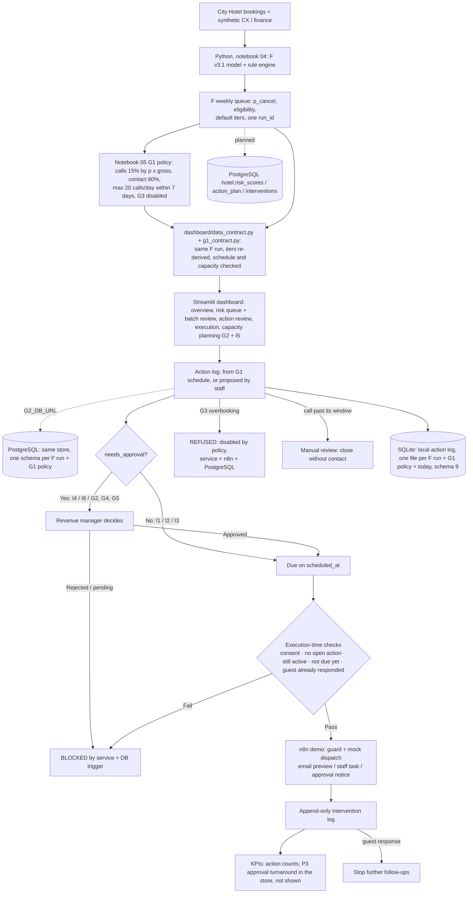

# G2: Technical architecture and workflow (v0.3, F v3.1 + G1 policy)

## System goal
Cancellation decision support for City Hotel (Lisbon). An academic prototype on 2017 bookings as F v3.1 scored them week by week. The dashboard works on one fixed day, today = 01/05/2017 (`G2_TODAY`), with the team's history up to yesterday prepared through the same service (`dashboard/seed_history.py`); they are not active reservations (real vs prepared: `dashboard/README.md`).

## Diagram

**Implemented now:** a loader that reads `artifacts/modeling/` directly, Streamlit UI, the action store with database guards on SQLite (default) or PostgreSQL (`G2_DB_URL`; `dashboard/pg_backend.py`, same rules and messages, all store tests pass on PostgreSQL 16), n8n webhook with guard and mock dispatch (Node.js tests, plus an end-to-end run on a local n8n 2.43.8: `tests/test_g2_n8n_live.py`). The `hotel` data-model migration stays `sql/g2_approval_guard_postgres.sql` (`sql/g2_verify_guard.sql`: 19/19 pass). **Planned:** a scheduled n8n flow reading PostgreSQL (below), real channels only after consent data exists.

## Workflow explanation
1. **F (weekly, end of booking week):** scores the bookings created that week and still eligible and writes its default tiers (5% / 20%), rules and schedule. **G1 (notebook 05)** freezes the policy chosen on 2016 (calls: top 15% by p × gross; contact: 60%; at most 20 calls a day within 7 days of the decision) and exports tiers, rules and a capacity-limited schedule for F's queue. G2 runs on G1, after re-deriving G1's tiers from F's scores and checking every dated action; it refuses a G1 built on another F run.
2. **Dashboard:** the daily flow is Overview → Risk Queue → Action Review → Execution & follow-up. The reservations team filters today's open bookings in the **Risk Queue** (ranked by tier then value at risk) and reviews G1's recommendations; **Execution & follow-up** lists what is due, ready or with the reason it cannot run, what failed in automation and each booking's history; the revenue manager sees, in **Capacity planning**, the expected cancellations per arrival date × room type, fed by the group rule (G2) and by high-risk bookings arriving within 7 days (I5), each source in its own columns. Its sum of p is an expected count of cancelled bookings, not rooms certain to be resold.
3. **Review, then action log:** a reviewer approves G1's routine recommendations (I1–I3) in a batch in the Risk Queue or one by one in Action Review; approval copies that booking's G1 schedule into `action_plan` in the same transaction (idempotent; one row per booking × type × due date) and records who decided (`plan_reviews`, one final decision per booking). A rejection needs a reason, and the database then refuses that booking's G1 plan. Staff may also propose an action by hand, or replace an open one (closed without contact and the new one proposed, in one transaction); the service refuses it if an open action of the same type exists, the limit is reached (max 2 reminders, 2 call attempts, 1 offer), the guest already responded, or the rule does not allow it (I4 only after a call where the guest asked to change, I6 only under a written deposit policy).
4. **Approval:** once their plan is approved, I1–I3 actions are `auto` (internal or standard messages, no second approval). I4, I6 and every enabled date × room-type action (capacity allocation, resale, price) start `pending` and need a named reviewer. G3 overbooking is disabled by the G1 policy: it is refused before approval, at execution, by n8n and by PostgreSQL, so no approval can enable it. The decision is final: the database refuses `rejected → approved`, `pending → auto` and any change of what was approved.
5. **Execution (simulated):** only on or after `scheduled_at` (today is fixed at start, `G2_TODAY`), and at most the G1 daily call capacity of phone calls per business day. A G1 call with no free slot (`manual_capacity_review`) has no automatic action. For guest actions, staff confirm consent, no other open action and that the booking is still active — these are `unknown` in the data and are never assumed. The outcome (no response / confirmed / requested change / cancelled) is logged; any response stops later follow-ups.
6. **n8n (optional):** the dashboard can send the action to the webhook instead, but only after the same local checks pass (`state_store.check_execution`), so a blocked action is never sent. The workflow re-checks approval, prechecks and due date, then builds what it *would* send (email preview, staff task, or approval notice) and sends nothing. Only an `accepted` reply is logged, as `executed_by = n8n`; the database guard still applies.
7. **Timeline rules:** per booking (and per date × room type) business time only moves forward, and history (responses, stop conditions) is read as of the date checked. A guest answer that arrives after the contact is recorded on its own date (`guest_responses`, append-only) and stops the remaining follow-ups from then on. Schema 4 uses a shared append-only `response_events` sequence, populated by SQLite insert triggers in the same transaction, to order contact outcomes and late answers within a day. An I4 offer must still have a latest change request from a phone call when executed, even after approval. The current store is schema 9 (default file `g2_demo_state_<F run>+<G1 policy>_<today>_v9.sqlite`): schema 5 added the frozen G1 execution policy, 6 the I4 offer basis, 7 closing an action without contact, 8 the database guards for concurrent writers (daily call limit, closed vs executed, G3 ban), 9 the staff review of routine G1 plans (`plan_reviews`) and the automation attempt log (`execution_attempts`). Older files are kept as they are, never converted, and a new file is opened.
8. **Concurrency:** one connection per browser session; every write is one transaction that takes the store's write lock first (SQLite: database write lock; PostgreSQL: row lock on `store_meta`, waits at most 15 s), so checks see the other sessions' commits. The n8n call happens inside that transaction. Triggers repeat the call limit, closed-vs-executed and G3 rules for direct SQL writers.
9. **Measurement:** KPI P3 (median approval turnaround) is computed from `action_plan` (`state_store.approval_kpis`) but not shown in the dashboard: approvals are stamped with the computer's clock, not the 2017 working day. Model quality is monitored on bookings arrived before today (Model monitoring page). Business KPIs (uplift, net benefit, ROI) need the randomised pilot with a holdout (`hotel.pilot_assignment`); the demo claims none.

## Production n8n flow (design, not built)
`Schedule trigger (every 15 min)` → `Postgres: SELECT due actions (scheduled_at ≤ now, executable, no intervention)` → `Postgres: re-read booking status, consent, open actions, latest guest response` → `IF checks pass` → `Switch action_type`: email/SMS node (confirm / reminder templates from CX), create task in the reservations queue (phone call), notify revenue manager (approved changes, done by staff in the PMS) → `Postgres: INSERT interventions (precheck JSON)` (the trigger is the last line of defence) → on guest reply webhook: log the response, which stops the remaining schedule. Errors go to a staff alert, never to a retry that could message a guest twice.

## Dependencies and boundaries
- **F** owns the model, tiers, rules and schedule; G2 reads one frozen run (`run_id` checked).
- **G1** owns thresholds / capacity N, costs, the value-at-risk definition, deposit and overbooking policy. Open points are listed in `G2_data_contract.md`.
- **C1** owns field definitions, real / synthetic flags, the stable `booking_id`.
- **G2** owns the website, automation prototype, tool choices, integration contract and approval-enforcement tests.

## Operational safeguards
- No guest contact data exists in the extract; **do not invent guest emails**. The demo sends nothing.
- No price, room or inventory change is made by the system; approved changes are carried out by staff.
- Post-outcome fields never reach the operational view (`read_queue` refuses them).
- The intervention log is append-only.
- The demo UI has **no authentication**: do not deploy it on a public server. SQLite is local demo state only; a PostgreSQL store needs its own database role, and the log triggers stay the last line of defence.
