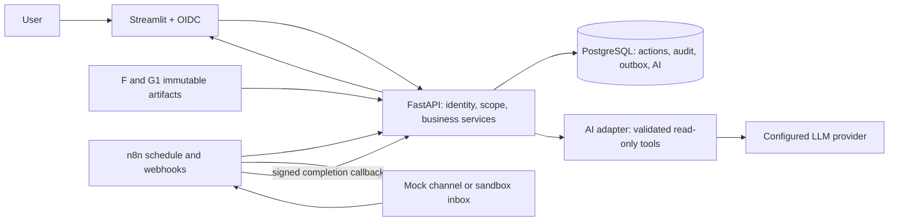

# Đặc tả nâng cấp City Hotel: Streamlit, n8n, AI và triển khai web

> **Phạm vi đã thay đổi ngày 21/10/2026:** dùng [SPEC_AI_N8N_VI.md](SPEC_AI_N8N_VI.md) cho đợt hiện tại: AI soạn ba loại email, triển khai Streamlit Community Cloud + n8n Cloud và lưu trạng thái bền vững. Tài liệu rộng bên dưới chỉ để tham khảo; không triển khai lại dashboard hoặc toàn bộ kiến trúc/auth trong tài liệu cũ.

**Ngày lập:** 21/10/2026. **Người thực hiện dự kiến:** Claude Opus 5.5 / coding agent do nhóm chọn.
**Trạng thái:** Đề xuất triển khai dựa trên code và dữ liệu hiện có; chưa phải tính năng đã xây dựng.
**Đích bàn giao:** Một web demo có đăng nhập, thao tác theo vai trò, AI có căn cứ, n8n chạy nền và kịch bản trình diễn hoàn chỉnh. Tích hợp PMS và liên hệ khách thật thuộc giai đoạn pilot riêng.

## 1. Quyết định sản phẩm

Giữ Streamlit làm ứng dụng chính, giữ mô hình XGBoost và chính sách G1. Nâng project thành **City Hotel Revenue & Operations Copilot**: người quản lý biết hôm nay cần làm gì, vì sao cần làm, ai duyệt, tự động hóa đã đi đến đâu và kết quả nào thực sự được ghi nhận.

Phân vai rõ:

- **ML hiện có:** tạo `p_cancel`; không giao LLM đoán xác suất hủy booking.
- **Python / G1:** tính số liệu, xếp hạng, lịch liên hệ, giới hạn cuộc gọi và kiểm tra nghiệp vụ.
- **Streamlit:** xem, lọc, hỏi AI, duyệt, xử lý ngoại lệ và so sánh kịch bản.
- **n8n:** lịch chạy, điều phối công việc, callback, báo lỗi và báo cáo định kỳ.
- **LLM:** diễn giải dữ liệu được cấp, soạn nháp và phân loại văn bản; không tự cấp quyền hoặc thực thi quyết định nhạy cảm.
- **PostgreSQL:** trạng thái dùng chung, hàng đợi bền vững, nhật ký và lịch sử AI.

Ưu tiên một web demo có chiều sâu, có bằng chứng hoạt động. Không viết lại bằng React, thêm nhiều agent tự trị, huấn luyện lại mô hình hoặc xây nền tảng nhiều khách sạn trong bản đầu.

## 2. Hiện trạng đã kiểm tra

| Thành phần | Bằng chứng trong project | Kết luận và hướng cải tiến |
|---|---|---|
| Dashboard | `dashboard/app.py`, `dashboard/views/*.py` | Đã có 8 trang, `st.navigation`, luồng công việc hằng ngày và trang phân tích. Cải tiến trên các trang này. |
| Mô hình + chính sách | `dashboard/data_contract.py`, `dashboard/g1_contract.py`, `artifacts/modeling/`, `artifacts/business_case/` | Đã kiểm tra một run F và G1 tương thích. Không thay bằng dữ liệu mẫu tùy ý. |
| Phê duyệt | `dashboard/state_store.py`, `sql/g2_state_store_postgres.sql` | Có guard, nhật ký append-only, giới hạn cuộc gọi, kiểm tra I4, cấm G3 và kiểm thử đồng thời. Phải bảo toàn. |
| Danh tính | `dashboard/common.py::reviewer_input` | Người duyệt đang nhập tên tự do; chưa có xác thực và phân quyền. |
| Lưu trữ | `dashboard/app.py`, `dashboard/pg_backend.py` | SQLite mặc định; đã hỗ trợ PostgreSQL qua `G2_DB_URL`. Không mô tả PostgreSQL như tính năng hoàn toàn chưa có. |
| Ngày làm việc | `dashboard/app.py`, `dashboard/seed_history.py` | Mặc định 01/05/2017, tạo lịch sử mô phỏng, log theo F + G1 + ngày. Cần tách đồng hồ demo và thời gian máy chủ. |
| n8n | `n8n/g2_approval_demo_workflow.json`, `n8n/src/guard.js`, `n8n/src/dispatch.js` | Webhook → guard → mock dispatch → trả lời. Chưa có quét lịch nền, gửi thật hoặc callback kênh gửi. |
| Kết quả gửi | `dashboard/n8n_client.py`, `state_store.execute_action` | `accepted: true` được ghi thành intervention mô phỏng dù n8n trả `executed: false`. Đúng với demo hiện tại, chưa đủ cho gửi thật. |
| Khóa giao dịch | `state_store.execute_action`, `dashboard/pg_backend.py` | HTTP tới n8n nằm trong giao dịch ghi. Đổi sang outbox để không giữ khóa khi chờ mạng. |
| AI hội thoại | Các module dashboard và n8n đã đọc | Chưa thấy lớp LLM, hỏi đáp tài liệu, brief AI hoặc quản lý nháp AI. |
| KPI | `dashboard/views/performance.py`, `state_store.approval_kpis` | Đã có KPI nghiệp vụ; approval turnaround chưa hiển thị vì vấn đề đồng hồ. Không được xem liên hệ đã ghi là doanh thu đã cứu. |

**Kiểm tra trực tiếp khi lập đặc tả:** `load_outputs()` tải thành công run `f-v3.1-2026-10-19_20261020-101915`: 13.156 booking, gồm 12.102 individual và 1.054 group; lịch G1 có 20.563 action; giới hạn 20 cuộc gọi/ngày; 17 booking cần manual capacity review. Streamlit trong môi trường kiểm tra là 1.66.0.

Đã chạy 5 test trong `tests/test_g2_n8n_client.py`, tất cả đạt. Lần chạy đầu gặp quyền thư mục tạm của môi trường; chạy lại với thư mục tạm trong workspace thì đạt. Đây là kiểm tra loader và client, **không phải** xác nhận toàn bộ test suite, PostgreSQL, giao diện browser hoặc n8n live đã chạy lại. Bản sao làm việc hiện tại không có thư mục `.git` được Git nhận diện.

## 3. Các ràng buộc phải giữ

1. Chỉ City Hotel, Lisbon; giữ `booking_id`, dữ liệu gốc và các artifact học thuật hiện có.
2. Dữ liệu lịch sử 2015–2017 vẫn là lịch sử; không đổi ngày để tạo cảm giác đây là booking thật năm 2026.
3. Operational view và context AI vận hành chỉ có thông tin được phép biết tại `as_of`. Không truyền nhãn hủy tương lai, `reservation_status` hoặc evaluation CSV vào đó.
4. Dữ liệu synthetic phải có nhãn trong bảng, biểu đồ, trả lời AI và file xuất.
5. Đọc chính sách G1 từ artifact: call tier 15% theo `p_x_gross`, tổng contact tier 60%, tối đa 20 call task/ngày, cửa sổ 7 ngày và tối thiểu 8 ngày trước arrival. Các giá trị này là hiện trạng, không copy thành hằng số mới.
6. Giữ G3 overbooking bị tắt. I6 deposit tắt mặc định; nháp AI không thể bật lại. Giữ binding của I4 với đúng sự kiện yêu cầu đổi từ cuộc gọi.
7. `sum(p_cancel)` là số booking hủy kỳ vọng; không tự chuyển thành số phòng chắc chắn trống, số room-night hoặc tồn kho có thể bán.
8. Gross value at risk và synthetic net contribution at risk là hai chỉ tiêu riêng. Giá trị rủi ro không phải doanh thu tăng thêm.
9. ROI, uplift, net benefit hiện tại là mô phỏng. Chỉ pilot treatment/holdout mới đánh giá được tác động thực nghiệm; không suy ra quan hệ nhân quả từ lịch sử liên hệ mô phỏng.
10. Không có địa chỉ khách trong dataset. Public demo không gửi ra người nhận thật, không sửa PMS, giá hoặc tồn kho thật.
11. Bảo toàn notebook, raw CSV, `requirements.txt` dùng cho tái lập F và hash trong manifest. Dependency web/AI bổ sung riêng.

## 4. Phạm vi và thứ tự ưu tiên

| Mức | Hạng mục | Giá trị | Điều kiện hoàn thành |
|---|---|---|---|
| P0 | Phân biệt demo/sandbox/pilot; đồng hồ và scope | Trình bày trung thực, tách dữ liệu người dùng | Kiểm thử không rò dữ liệu và không lấy dữ liệu tương lai |
| P0 | Đăng nhập, phân quyền, audit identity | Web nhiều người dùng | API chặn thao tác sai quyền, không chỉ ẩn nút |
| P0 | Outbox, trạng thái thực thi, chống trùng | n8n chạy nền có kiểm soát | Không nhân đôi khi click lại, callback lặp hoặc restart |
| P0 | Docker Compose, PostgreSQL, HTTPS | Có đường triển khai web rõ ràng | Một lệnh chạy local, cấu hình staging đầy đủ |
| P1 | Today brief + Booking 360 | Giảm thời gian đọc bảng | Drill-down từ số liệu về booking/action nguồn |
| P1 | AI copilot chỉ đọc + dẫn chứng | Hỏi đáp có căn cứ | Đạt bộ đánh giá AI, lỗi AI không chặn dashboard |
| P1 | Message studio + nháp được duyệt | Cá nhân hóa có kiểm soát | Duyệt đúng phiên bản nội dung; sandbox nhận được bản mô phỏng |
| P1 | Automation center + 5 workflow n8n | Theo dõi từ đầu đến cuối | Có retry, lỗi, callback, pause và nhật ký liên kết |
| P1 | Scenario lab | Thể hiện giá trị BA | So sánh giả định có nguồn và không sửa policy đang chạy |
| P2 | Reply triage, SHAP được kiểm chứng, pilot KPI | Độ sâu sau MVP | Có dữ liệu và test riêng trước khi bật |
| P2 | PMS/channel integration, scoring dữ liệu mới | Thử nghiệm vận hành thật | Hợp đồng dữ liệu mới, consent, pilot và kiểm định mô hình |

**MVP bàn giao = P0 + P1.** P2 không phải điều kiện để hoàn thành demo. P0 là nền kỹ thuật; triển khai một lát cắt sớm từ xem booking → duyệt → hàng đợi → n8n mock → callback → timeline để tránh làm hạ tầng quá lâu mà chưa có sản phẩm xem được.

## 5. Người dùng và quyền

| Vai trò | Quyền được cấp |
|---|---|
| Public viewer | Xem snapshot demo công khai, tài liệu giới thiệu và câu trả lời AI đã tạo sẵn; không gọi AI trả phí tùy ý, không ghi dữ liệu |
| Analyst | Xem dữ liệu trong scope, hỏi AI chỉ đọc, chạy scenario và xuất báo cáo |
| Reservations | Quyền đọc; xử lý review thường lệ I1–I3, tạo nháp, ghi kết quả cuộc gọi và đóng việc có lý do |
| Revenue manager | Quyền Reservations; duyệt hành động nhạy cảm được policy cho phép và nội dung gửi |
| Admin | Quản lý vai trò, cấu hình và vận hành; không tự động có quyền duyệt nghiệp vụ nếu chưa được cấp |
| n8n service | Claim job, kiểm tra trước gửi, ghi kết quả/callback và yêu cầu brief; không duyệt action, không tự cấp role |

- Dùng OIDC với `st.login`, `st.user`, `st.logout`. OIDC xác minh danh tính; ứng dụng tự thực thi RBAC và kiểm tra scope. [Tài liệu Streamlit](https://docs.streamlit.io/develop/concepts/connections/authentication).
- Khóa user theo `(issuer, subject)`; không dùng tên tự nhập hoặc email đơn lẻ làm danh tính phê duyệt.
- Role được quản lý phía server, deny-by-default. Người vào sandbox có quyền demo trong sandbox của mình, không có quyền ở scope pilot.
- Public viewer dùng một snapshot chỉ đọc; người đăng nhập thử thao tác nhận `sandbox_id` riêng. Hai trình duyệt mở cùng tài khoản được thấy cùng sandbox nếu backend cho phép; hai tài khoản khác nhau không thấy nhau.
- Kiểm tra quyền ở service/API mỗi lần ghi, kể cả khi tab đã mở lâu. Thu hồi role phải có hiệu lực với thao tác tiếp theo.

## 6. Đặc tả giao diện Streamlit

### 6.1 Bố cục chung

Giữ nhóm điều hướng hiện tại, thêm AI copilot và Automation center. Booking 360 là màn hình chi tiết mở từ queue; Message studio nằm trong Action Review; Scenario lab mở từ Capacity planning. Tránh thêm một trang riêng cho mọi chức năng nhỏ.

Header luôn có mode, business date, lần cập nhật gần nhất và danh tính. Run/model/policy để trong phần chi tiết. UI mặc định tiếng Anh theo project; tài liệu hướng dẫn tiếng Việt. Nháp liên hệ cho chọn EN/PT; chưa cần dịch toàn bộ UI trong MVP.

Dùng native Streamlit, theme trong `.streamlit/config.toml`, Material icons, bảng chọn hàng, metric và chart có đơn vị. Tái sử dụng các token UI hiện có; không thêm CSS phụ thuộc DOM nội bộ. Màu high/medium/low đi cùng chữ và icon. Bố cục rõ ở 1366×768, dùng được ở 768 px; màn hình hẹp chuyển phần chi tiết xuống dưới bảng.

Mỗi vùng có trạng thái loading, empty, stale và error. Hiển thị UI trước công việc chậm; `st.form` gom bộ lọc, `st.fragment` làm mới tiến độ riêng. Không gọi LLM lại mỗi lần đổi widget. Cache dữ liệu theo run/policy/scope/as_of/version; không cache chung kết quả riêng của nhiều người. Không chia sẻ một DB connection đang có transaction giữa các session/fragment.

### 6.2 Today / Overview

- Giữ KPI hiện có; gom thành: việc cần duyệt, action đến hạn, công suất cuộc gọi còn lại, việc tự động hóa cần xử lý.
- Bổ sung **Today's brief**: tối đa 5 ý, gồm tình hình, ưu tiên, việc đang bị chặn và điểm chưa biết.
- Mỗi số liệu có khoảng thời gian, nhóm booking, đơn vị và nút mở bảng nguồn. Với demo dùng “simulated contact”, không dùng “guest contacted” như sự kiện thật.
- LLM chỉ diễn giải `DailySummary` đã tính bằng Python. Nếu LLM lỗi, hiển thị brief mẫu từ cùng số liệu.
- Có nút “Generate brief”, thời điểm tạo và báo “Out of date” khi context thay đổi; không âm thầm dùng brief cũ.

### 6.3 Risk Queue + Booking 360

- Giữ lọc, review hàng loạt và lịch G1; thêm lưu bộ lọc theo user, chọn booking, xem timeline và trạng thái người phụ trách.
- Booking 360 hiển thị: dữ kiện booking → model score → policy/rule → lịch hành động → review/approval → job n8n → kết quả → phản hồi.
- “Why this action?” giải thích quy tắc G1 bằng dữ liệu xác định. “Why this risk score?” chỉ xuất hiện khi có đóng góp đặc trưng thực sự tính từ model tương thích; nếu chưa có thì ghi chưa có local explanation.
- Không gọi lead time/market segment là nguyên nhân hủy chỉ vì chúng hiện diện trong booking.
- Batch review có bảng preview, số dòng đủ điều kiện và lý do loại; backend kiểm tra lại từng dòng khi submit, trả kết quả theo dòng. Mỗi dòng nguyên tử; không báo cả batch thành công nếu có dòng bị từ chối.

### 6.4 Action Review + Message studio

- Hiển thị dữ kiện nguồn và policy cạnh nháp. AI tạo subject/body hoặc call script, kèm `missing_fields`, nguồn và những điểm cần người kiểm tra.
- Không đưa điểm rủi ro hủy, nhận định chủ quan về khách hoặc dữ liệu tài chính nội bộ vào email.
- Không bịa ưu đãi, điều kiện hoàn tiền, tiền đặt cọc, tồn kho hoặc contact. Thiếu thông tin thì dùng chỗ trống có nhãn và chặn gửi cho đến khi được xử lý.
- User sửa nháp → tạo revision mới. Approval gắn với `action_id + action_version + draft_hash + policy_version`; thay nội dung sau duyệt làm mất hiệu lực approval gửi.
- Review kế hoạch, duyệt hành động nhạy cảm và duyệt nội dung là các quyết định riêng. Gửi nháp không thay thế phê duyệt nghiệp vụ.
- I1–I3 dùng template cố định đã duyệt trước vẫn theo luồng hiện có; nháp AI hoặc nội dung sửa thủ công phải được Revenue manager duyệt trước dispatch.

### 6.5 Execution & follow-up + Automation center

- Timeline phân biệt “reviewed”, “approved”, “queued”, “processing”, “simulated”, “provider accepted”, “delivered”, “task created”, “staff completed”, “failed”, “unknown”, “blocked”.
- Chỉ hiện “delivered” khi có bằng chứng từ provider; phone task tạo thành công chưa có nghĩa đã gọi.
- Có bộ lọc job lỗi/chưa rõ kết quả, attempts, reason code, lần thử kế tiếp và link n8n execution cho user có quyền.
- Retry chỉ với lỗi retryable; `unknown` phải đối soát. Pause automation ngăn claim mới; job đang gửi có thể đã qua điểm hủy, phải hiển thị riêng.
- Poll tiến độ mỗi 5–10 giây bằng fragment khi trang đang mở. Refresh tiến độ không tạo lại job.

### 6.6 Capacity planning + Scenario lab

- Giữ buffer group/I5, hiển thị grain arrival-date × room-type và cảnh báo chưa phải tồn kho theo từng stay-night.
- Kịch bản cho thay call capacity, contact shares và các giả định uplift/cost trong khoảng cấu hình cho phép.
- Tái sử dụng hàm tính từ `src/g1_decision.py`, `src/scenario_capacity.py` qua wrapper thuần; không chạy notebook hoặc ghi đè artifact gốc từ UI.
- So sánh baseline, low/base/high assumptions: task cần xử lý, overflow, chi phí liên hệ, net benefit mô phỏng; công thức và nguồn giả định truy cập được.
- Lưu `scenario_id`, creator, inputs, seed, run/policy, business horizon và outputs. Kịch bản không thay policy đang vận hành; MVP không có nút “apply policy”.
- Nếu tính hindsight cần nhãn tương lai, bắt buộc đặt ở retrospective analysis, không trộn vào quyết định tại ngày replay.

### 6.7 Performance / Model monitoring / Data scope

- Giữ tách chất lượng dự báo, hoạt động vận hành và hiệu quả tài chính mô phỏng.
- Hiển thị approval latency theo thời gian server của các event mới; loại seeded history khỏi KPI này. Muốn báo business-day delay thì phải có cả hai mốc business time tương thích.
- Bổ sung số request AI, latency, số token, tỷ lệ fallback, chi phí ước tính; không hiện số tiền 0 khi chưa cấu hình đơn giá.
- Bảng provenance: artifact, run, policy, checksum, source type, as_of và nhãn historical/synthetic/simulated.
- P2 mới có treatment/holdout outcomes, uplift và confidence interval; khi thiếu pilot hiện “Not measured”, không điền 0.

## 7. Kiến trúc đích



FastAPI là lớp nhỏ để UI và n8n dùng chung kiểm tra, không phải lý do viết lại business logic. Tách dần hàm từ `state_store` thành service/repository, giữ facade để test và local demo còn chạy. Trong hosted mode, UI/n8n không ghi thẳng bảng nghiệp vụ.

MVP một instance Streamlit, một API và một n8n là đủ để kiểm chứng. Chưa cần Redis/Celery/Kubernetes; outbox PostgreSQL chứa công việc, n8n claim batch có giới hạn. Việc thêm worker/queue mode về sau phải dựa trên đo tải.

### 7.1 Mode và đồng hồ

- `local_demo`: tương thích entrypoint hiện có, SQLite và fixed date; không public.
- `public_demo`: snapshot chỉ đọc, không chức năng tốn phí theo yêu cầu khách ẩn danh.
- `sandbox`: đăng nhập, scope riêng, replay 2017, mock dispatch và AI có quota.
- `pilot`: cấu hình riêng, tắt mặc định; chỉ dùng khi có booking/consent/contact thật và quy trình pilot.

`business_as_of` là ngày mô phỏng hoặc business time của hotel; `recorded_at`/`received_at` là UTC timestamp thật. Pilot dùng timezone `Europe/Lisbon`, không dùng timezone máy lập trình để đặt lịch hotel. Tất cả interval và daylight-saving phải có test.

MVP sandbox giữ ngày cố định 01/05/2017. Nếu thêm date picker, tạo replay branch mới gắn với ngày và lineage, không kéo đồng hồ lùi trong log đang dùng. Lịch sử seed chỉ thuộc demo, có `is_seeded`, không đi qua external dispatch và không tính là tác động thực tế.

### 7.2 Danh tính từ Streamlit đến API

Không giả định `st.user` là access token có thể dùng trực tiếp ở FastAPI. Đề xuất MVP: Streamlit server xác thực OIDC, rồi ký assertion nội bộ ngắn hạn từ `issuer/sub` lấy ở session đã xác thực. API kiểm tra chữ ký, issuer, audience, expiry và request nonce; tra role/scope từ DB, không nhận role do client khai.

Khóa ký chỉ có ở server, public key ở API; assertion không lộ ra browser. API không chấp nhận `X-User-Email` hay `reviewer` tự khai làm danh tính. n8n có service credential riêng, quyền hạn riêng và không được dùng assertion người dùng. Nếu chọn auth gateway thay cho cách này, phải ghi ADR và test tương đương trước triển khai.

## 8. Dữ liệu và API contract

### 8.1 Schema bổ sung dự kiến

Giữ ý nghĩa các bảng hiện có: `action_plan`, `plan_reviews`, `interventions`, `guest_responses`, `response_events`, `action_closures`, `execution_attempts`. Dùng migration có version; không sửa file DB cũ trực tiếp để ép tương thích.

| Bảng mới / mở rộng | Trường chính và yêu cầu |
|---|---|
| `app_users`, `role_bindings`, `scopes` | issuer, subject, role, scope, status; uniqueness theo issuer/subject và role/scope |
| `runs` | F run, G1 policy, artifact checksum, business date, mode, seed provenance |
| Hosted action extensions | scope_id, source_run_id, policy_version, action_version; identity bất biến |
| `automation_jobs` | job_id, scope_id, action_id, approved_draft_hash, idempotency_key, status, lease_token, lease_until, attempt_count, next_attempt_at, provider_message_id |
| `automation_events` | append-only; job_id, event_id, status, recorded_at, business_as_of, reason_code, correlation_id |
| `message_drafts`, `draft_approvals` | revision, content_hash, source_context_hash, creator/reviewer, model/prompt version, decision |
| `inbound_events` | provider_event_id unique trong provider/channel/scope, received_at, contact identity, response proposal, review status |
| `ai_requests` | task type, model, prompt version, input hash, output, source refs, token usage, latency, fallback, reviewer feedback |
| `scenario_runs` | parameters, outputs, source hashes, owner, created_at, mode |

Mọi query, cache, export, AI tool và callback phải giới hạn scope phía server. Nếu dùng RLS thì test cả RLS và service checks. Không tạo schema cho mỗi lần refresh hoặc mỗi request. Hosted mode dùng schema ứng dụng có scope; local legacy vẫn giữ cơ chế cũ. Có foreign key/composite key phù hợp để action của scope A không tham chiếu job/draft của scope B.

### 8.2 API tối thiểu

| Endpoint dự kiến | Contract |
|---|---|
| `GET /v1/summary`, `/bookings`, `/bookings/{id}` | Chỉ dữ liệu được phép biết trong scope/as_of; pagination và filter allowlist |
| `POST /v1/plans/review` | Danh sách booking, decision, reason, expected_version; kết quả từng booking |
| `POST /v1/actions/{id}/decision` | Nhạy cảm chỉ manager; approval bất biến; stale version trả 409 |
| `POST /v1/actions/{id}/drafts` | Tạo nháp, không gửi; gồm language, task type, context version |
| `POST /v1/drafts/{id}/approval` | Duyệt đúng content hash và action version |
| `POST /v1/actions/{id}/enqueue` | Recheck quyền/guard; tạo job idempotent; 202 nghĩa đã xếp hàng |
| `POST /v1/automation/claim` | n8n-only, batch có lease; không nhận approval/precheck từ payload làm sự thật |
| `POST /v1/jobs/{id}/authorize-dispatch` | Recheck trạng thái mới nhất và cấp quyền gửi ngắn hạn cho đúng lease/version |
| `POST /v1/automation/events` | Signed callback; event unique, versioned, kiểm tra chuyển trạng thái |
| `POST /v1/guest-responses` | Sự kiện đã xác thực hoặc nhập bởi nhân viên; không tự sửa booking từ lời LLM |
| `POST /v1/ai/query`, `/v1/ai/brief` | Chỉ tool đọc allowlist; quota và context hash |
| `POST /v1/scenarios` | Tính riêng, lưu riêng, không thay policy |
| `GET /health/live`, `/health/ready` | Tối thiểu trạng thái tiến trình, DB, migration/artifact sẵn sàng; không lộ secret |

Envelope lỗi thống nhất: `code`, `message`, `correlation_id`, `retryable`, `details`. Không hiển thị DSN, token hoặc trace chứa dữ liệu nhạy cảm cho browser.

## 9. Outbox, chống trùng và trạng thái gửi

### 9.1 Luồng xử lý

1. User submit → service xác thực, scope, version, policy, due date, approval và draft hash.
2. Trong transaction ngắn: tạo `automation_job` và audit enqueue với unique idempotency key; commit rồi trả `202 + job_id`.
3. n8n claim bằng lease và khóa dòng tương đương `FOR UPDATE SKIP LOCKED`; API chỉ trả job thuộc service scope. Không giữ transaction trong lúc gọi mạng/AI.
4. Trước dispatch, API đọc lại consent, active status, stop condition, approval, latest response, capacity và content version; trạng thái thiếu dữ kiện thì blocked.
5. n8n gọi mock/sandbox adapter; ghi provider reference và callback về API. API cập nhật job cùng event log bằng transaction.
6. UI đọc trạng thái job. Một callback không tự tạo “guest confirmed”; phản hồi khách là event riêng.

`idempotency_key` phải chứa scope + source run + action identity + approved content version; retry của cùng job luôn giữ nguyên key. Thêm unique constraint để cùng action không có nhiều job đang hoạt động. Sửa nội dung của action đã gửi không tạo cơ hội gửi lại; liên hệ mới phải là action mới qua các guard về số lần.

### 9.2 Quy tắc trạng thái

```text
queued -> leased -> dispatching -> simulated
                             -> provider_accepted -> delivered / bounced
                             -> task_created -> staff_completed
                             -> retryable_failure -> queued
                             -> unknown -> reconciled_success / reconciled_failure / manual_review
queued / leased -> blocked / cancelled_before_dispatch
```

- Không đảm bảo “exactly once” cho một hệ thống bên ngoài không hỗ trợ idempotency/đối soát. Mục tiêu là chống trùng ở DB và sử dụng idempotency của provider khi có.
- Timeout sau khi provider có thể đã nhận: `unknown`, không tự gửi lại. Nếu provider hỗ trợ status lookup/key, đối soát trước; nếu không thì manual review.
- Worker chết khi đang `leased` có thể reclaim sau expiry; chết khi đã `dispatching` phải xác định có khả năng gửi ra ngoài hay chưa, không blind retry.
- Callback cũ hoặc lease hết hạn không được ghi đè kết quả mới. Callback lặp trả thành công idempotent; callback sai scope/chữ ký bị từ chối.
- Booking có phản hồi mới tạo hold/stop trước các lượt gửi chưa bắt đầu. Serialize bước authorize-dispatch và cập nhật stop theo booking. Sau khi đã dispatch ra mạng có thể không hủy được; ghi rõ thời điểm và chuyển ngoại lệ cho staff, không tuyên bố đã thu hồi email.
- Call task reservations và cuộc gọi staff hoàn thành dùng cùng cơ chế capacity: tính cả slot đang giữ và đã dùng, không đếm một slot hai lần; hết lease/đóng chưa gọi mới giải phóng theo policy. Kiểm tra lại ngày/cửa sổ khi staff ghi hoàn thành.
- Template preview hoặc task_created không được cộng vào contacts completed. Giữ semantics demo cũ ở local adapter; hosted KPIs lấy event mới theo loại kết quả.

## 10. Năm workflow n8n của MVP

| Workflow | Trigger và các bước | Kết quả |
|---|---|---|
| `W01_dispatch_due_actions` | Schedule mỗi phút → API claim → chia batch → authorize-dispatch → switch channel → mock/sandbox adapter → signed callback | Action đến hạn được xử lý bền vững |
| `W02_execution_events` | Webhook xác thực → validate schema → deduplicate → API ghi provider event → trả response | Tiến độ và kết quả cập nhật đúng |
| `W03_guest_response` | Webhook sandbox / staff input → xác thực liên hệ → API ghi inbound event và hold → staff review response | Dừng follow-up đúng lúc, có lịch sử |
| `W04_daily_brief` | Schedule 08:00 Europe/Lisbon hoặc manual demo → API lấy summary → AI brief có validation → lưu brief | Báo cáo mở trong dashboard; email nội bộ chỉ khi cấu hình người nhận |
| `W05_error_handler` | Error Trigger → chuẩn hóa lỗi → API ghi alert → retry nếu đủ điều kiện hoặc manual review | Không mất lỗi; không báo lặp không giới hạn |

Xuất JSON workflow import được, README các credential cần tạo, request/response fixtures và hướng dẫn publish. Giữ workflow demo cũ để regression. Không nhúng secret vào JSON.

Webhook phải xác thực; callback dùng chữ ký body + timestamp + nonce với cửa sổ chống replay, hoặc cơ chế tương đương được kiểm thử. Production URL và test URL là hai endpoint khác nhau, không dùng “Listen for test event” làm đường chạy web. [Webhook docs](https://docs.n8n.io/integrations/builtin/core-nodes/n8n-nodes-base.webhook).

Error workflow dùng Error Trigger; kiểm thử bằng execution thật của workflow đã publish. Chính sách retry của app vẫn phải phân biệt `retryable` và `unknown`, không bật retry toàn luồng một cách mù quáng. [Error handling docs](https://docs.n8n.io/build/flow-logic/handle-errors-gracefully.md).

MVP giới hạn channel ở mock hoặc inbox thử nghiệm nằm trong hạ tầng demo. UI và n8n đều không có recipient tự do. Scheduled trigger chỉ poll, không tự đổi ngày replay và không tự retrain model.

## 11. Đặc tả AI

### 11.1 Các tác vụ

| Tác vụ | Input hợp lệ | Output | Giới hạn |
|---|---|---|---|
| Daily brief | Aggregate đã lọc scope/as_of, pending actions, capacity | 3–5 insight có source ref và liên kết xem chi tiết | Không tính KPI bằng LLM |
| Booking explanation | Booking snapshot + rule trace; contribution thật nếu có | Giải thích score/policy tách biệt, điều chưa biết | Không suy diễn nhân quả |
| Message drafting | Booking facts tối thiểu + template/policy được duyệt | Subject/body/call script, missing fields | Không tự gửi, không bịa ưu đãi |
| Ask the project | Tài liệu được duyệt + công cụ thống kê chỉ đọc | Trả lời và nguồn | Không SQL/Python tùy ý |
| Reply triage (P2) | Văn bản phản hồi được che PII | Nhãn đề xuất, evidence spans, cần review hay không | Không tự xác nhận hủy booking hoặc tạo I4 |

### 11.2 Công cụ được phép

`get_daily_summary`, `list_priority_bookings`, `get_booking_snapshot`, `get_action_timeline`, `get_policy_rule`, `get_model_metrics`, `compare_saved_scenarios`, `search_project_docs`.

Backend tự gắn scope/as_of vào mọi tool, validate tham số bằng schema và áp row limit. LLM không được chọn scope mới, path tùy ý, database table hoặc arbitrary URL. Không cung cấp tool approve/enqueue/send/change_price/delete cho AI.

Knowledge base MVP là tài liệu allowlist: README, G1/G2 contracts, decision table, pilot plan, model report và assumptions. Chunk theo heading, lưu file/section/hash. Dùng tìm kiếm từ khóa/PostgreSQL full-text trước; chỉ thêm embeddings nếu đánh giá retrieval cho thấy cần. Không cần vector database riêng ở MVP.

Tài liệu model report có kết quả retrospective: đánh dấu `retrospective_evaluation`. Được trả lời câu hỏi phương pháp/kết quả nghiên cứu nhưng không dùng số liệu tương lai để đề xuất hành động tại ngày replay. Context builder tách `operational` và `retrospective`, không chỉ nhắc trong prompt.

### 11.3 Output và kiểm chứng

Schema đề xuất:

```json
{
  "answer": "...",
  "claims": [
    {"text": "...", "evidence_ids": ["summary:due_actions"], "metric_keys": ["due_actions"]}
  ],
  "missing_data": [],
  "suggested_next_steps": [],
  "requires_human_review": true
}
```

Metadata do **server** bổ sung, không tin LLM tự khai: request_id, scope, mode, as_of, run_id, policy_version, source_context_hash, provider/model, prompt_version, generated_at, input/output token và estimated_cost.

- Dùng structured output nếu model thực tế hỗ trợ; luôn validate phía server. JSON đúng schema chưa đảm bảo nội dung đúng. [Claude structured outputs](https://platform.claude.com/docs/en/build-with-claude/structured-outputs).
- Evidence ID phải tồn tại trong context cùng request. Dẫn nguồn là link nội bộ đến metric, booking, policy section hoặc artifact snapshot, không phải chuỗi nguồn tự bịa.
- Metric được render từ dữ liệu tính sẵn. Nếu AI viết số trái với metric hoặc nguồn không tồn tại, chặn hiển thị kết quả đó và dùng fallback.
- Không dùng confidence do LLM tự chấm như xác suất đúng. Nếu có quality status, lấy từ kiểm tra schema, coverage và evidence validation.
- Văn bản khách/tài liệu là dữ liệu không đáng tin về mặt chỉ dẫn. Yêu cầu trong đó không được thay system rules, mở tool mới, tiết lộ khóa hoặc đổi quyền.

### 11.4 Provider, hiệu năng và ngân sách

- `AI_ENABLED`, `AI_PROVIDER`, `AI_MODEL`, `AI_TIMEOUT_SECONDS`, `AI_MAX_OUTPUT_TOKENS`, quota theo user/task/ngày và ngân sách theo deployment là cấu hình server.
- Claude Opus 5.5 là coding agent theo yêu cầu nhóm; không suy ra đó là model runtime đã được tài khoản API cấp quyền. Claude triển khai phải xác minh model ID/capability thực tế, không bịa ID hoặc gắn cứng tên marketing.
- Runtime adapter có interface provider độc lập; MVP chỉ cần một provider hoạt động và một fake provider deterministic cho test/offline.
- API key nằm trong secrets server. Gửi dữ liệu tối thiểu; không gửi raw CSV toàn bộ, contact hoặc secret sang LLM. Log prompt có redaction và retention cấu hình.
- Cache theo task/model/prompt version/context hash/scope/as_of; context đổi thì kết quả stale. Giới hạn concurrency; nút bấm lặp không tạo nhiều request tính phí.
- Timeout/lỗi/rate limit/quota: template fallback và retry thủ công. Dashboard/approval vẫn hoạt động khi AI tắt.
- Mọi mức token, thời gian, quota và ngân sách đề xuất là thông số vận hành mới, không chèn vào giả định kinh tế Lisbon 2015–2017.

## 12. Triển khai lên web

### 12.1 Phương án khuyến nghị: một stack Docker Compose trên VPS

Các service: reverse proxy HTTPS, Streamlit, API, PostgreSQL, n8n và mock/sandbox inbox khi cần. Cơ sở dữ liệu app và dữ liệu nội bộ n8n dùng database/role riêng; không chia sẻ quyền admin. Persistent volumes cho PostgreSQL và n8n; artifact F/G1 được mount/read-only hoặc đóng gói snapshot có checksum.

Chỉ public cổng proxy cần thiết. n8n editor và API quản trị không mở ẩn danh. Cấu hình WebSocket cho Streamlit, URL callback OIDC, external webhook URL n8n và trusted proxy phù hợp. Không tắt bảo vệ XSRF để xử lý lỗi proxy.

Pin phiên bản dependency/image đã kiểm thử; không dùng `latest`. Khởi đầu từ Streamlit 1.66.0 và n8n 2.43.8 ghi trong project, xác minh tương thích trước khi thay. Không dùng hướng dẫn môi trường hiện tại như cam kết rằng mọi package đã chạy được trên Python khác.

Docker Compose là đường self-host có tài liệu chính thức của n8n; chỉ lấy phần cần cho stack này, không cần bổ sung n8n Assistant hay sandbox chạy code AI của n8n. [Tài liệu triển khai n8n](https://docs.n8n.io/deploy/host-n8n/install-options/install-using-docker-compose.md).

### 12.2 Phương án phụ: Streamlit Community Cloud

Dùng cho dashboard public chỉ đọc hoặc frontend kết nối backend đã host riêng; n8n/API/PostgreSQL vẫn cần dịch vụ riêng. Không dùng file SQLite local như trạng thái nhiều người dùng cần lưu lâu dài.

Lưu ý project có cả `requirements.txt` cho training và `requirements-g2.txt`. Không giả định Community Cloud tự chọn file `requirements-g2.txt`: chuẩn bị manifest dependency đúng vị trí được nền tảng nhận diện, ví dụ `dashboard/requirements.txt`, hoặc deployment repo riêng. Giữ `.streamlit/config.toml` tại root. [Quy tắc tổ chức file](https://docs.streamlit.io/deploy/streamlit-community-cloud/deploy-your-app/file-organization).

### 12.3 Deliverable triển khai

- `Dockerfile` riêng hoặc multi-stage cho web/API; `compose.yaml`, `.env.example`, `.dockerignore`, healthchecks.
- Dependency web/AI được khóa riêng; không vô tình kéo notebook training vào image dashboard.
- Migration một lần trước startup, seed demo qua job rõ ràng, không chạy lại trên mỗi rerun.
- Backup PostgreSQL và n8n encryption key; có hướng dẫn restore đã thực hành trên staging. Không ghi secret trong repo hoặc output test.
- Giữ deploy trước để rollback; migration tương thích ngược hoặc có kế hoạch phục hồi snapshot. Không reset/drop dữ liệu để sửa lỗi triển khai.
- Runbook: setup domain/HTTPS, OIDC, secrets, import/publish workflow, start/stop, xem logs, pause dispatch, backup/restore và đổi model.
- Nếu chưa có hosting account/domain/credentials, bàn giao stack local đã kiểm thử và danh sách cấu hình còn thiếu. Chỉ ghi “đã deploy” khi có URL được truy cập và kiểm chứng.

Không đưa báo giá cloud/AI cố định vào đặc tả này. Claude cần lập bảng tài nguyên và chi phí theo cấu hình/nhà cung cấp thật lúc deploy. Chi phí vận hành demo năm 2026 phải tách khỏi business case lịch sử.

## 13. Kế hoạch sửa code

| Khu vực | Công việc |
|---|---|
| `dashboard/app.py`, `common.py` | Mode, danh tính, scope, clock, context; thay reviewer tự nhập trong hosted mode |
| `dashboard/views/` | Nâng các trang hiện có; thêm `ai_copilot.py`, `automation_center.py`; chi tiết booking và scenario dùng module chia sẻ |
| `dashboard/state_store.py`, `pg_backend.py` | Giữ API compatibility cho local demo; tách service/repository và thêm hosted persistence qua migration |
| `dashboard/n8n_client.py` | Giữ legacy client; hosted chuyển enqueue/status, không HTTP network trong write transaction |
| `backend/` mới | FastAPI, auth, RBAC, DTO, business services, outbox, callback, repositories |
| `ai/` mới | Context builders, tools chỉ đọc, provider adapter, schemas, prompts versioned, validation, fallback, evals |
| `n8n/workflows/` mới | W01–W05, fixtures và kiểm thử workflow; giữ workflow demo cũ |
| `sql/migrations/` mới | Schema hosted có version, roles/scopes, job/event/draft/AI; bảo toàn append-only |
| `config/` | Cấu hình app/AI riêng; assumptions kinh tế cũ giữ nguyên trừ thay đổi có luận cứ |
| `tests/` | Regression, auth/scope, state machine, workflow, AI eval, AppTest và end-to-end |
| `deploy/`, `docs/` | Docker/runbook, kiến trúc mới, threat/identity ADR ngắn, API contract, demo script, báo cáo kiểm thử |

Không cần đúng mọi tên file đề xuất; Claude được gom module cho gọn, nhưng các boundary và nghiệm thu vẫn bắt buộc. Không “hoàn thành” bằng placeholder, `pass`, pseudo-workflow hoặc UI hiển thị success chưa có backend.

## 14. Kiểm thử và tiêu chí nghiệm thu

### 14.1 Regression

- Chạy test suite hiện có với dependency phù hợp; ghi rõ pass/fail/skip. PostgreSQL/n8n live test chỉ tính là đã kiểm chứng khi có service thật.
- Giữ đầy đủ test chống leakage, G1 schedule/capacity, I4 basis, G3 disabled, replay, closure, review và concurrency. Thay test chỉ khi semantics mới có chủ đích và có giải thích.
- Loader vẫn tải đúng snapshot F/G1; local `run_demo` còn dùng được hoặc có migration guide tương đương.

### 14.2 Các tình huống bắt buộc

| ID | Given / When | Expected |
|---|---|---|
| A01 | Public viewer / analyst gọi API duyệt | 401/403; không ghi action/approval |
| A02 | User A đưa ID action/job/draft của B | Không đọc/ghi được; export và AI cũng không rò dữ liệu |
| A03 | Hai manager duyệt cùng phiên bản | Một quyết định cuối cùng; request stale nhận 409/idempotent response phù hợp |
| A04 | G3 hoặc I6 bị policy tắt, dù AI khuyên làm | Service, API và worker đều chặn |
| A05 | I4 có response mới sau approval | Approval cũ không authorize dispatch |
| J01 | Double-click enqueue / hai n8n worker claim | Một job hiệu lực, một lease có quyền dispatch |
| J02 | Provider đã nhận nhưng callback mất | Unknown/reconcile; không tự gửi trùng |
| J03 | Callback trùng, sai chữ ký hoặc sai scope | Trùng không nhân event; sai bị từ chối |
| J04 | Booking phản hồi trước dispatch authorization | Follow-up không được gửi; lịch sử có lý do |
| J05 | Hai session cùng tranh slot cuộc gọi cuối | Không vượt capacity; task pending và completed không đếm hai lần |
| J06 | n8n/API restart giữa các bước | Job còn trong DB; lease phục hồi/đối soát; không mất audit |
| J07 | Sửa nháp sau duyệt | Chặn enqueue/dispatch cho đến khi revision mới được duyệt |
| T01 | Đổi as_of hoặc xem dữ liệu tương lai | Operational context không có future outcome; cache đúng scope/time |
| T02 | Seeded demo + event server mới | Approval latency không tính lẫn hai đồng hồ |
| AI01 | AI bị tắt, timeout hoặc hết quota | UI/approval vẫn chạy; fallback có nhãn |
| AI02 | Prompt yêu cầu gửi email hoặc đổi policy | Không có write tool; không phát sinh side effect |
| AI03 | Tài liệu/guest message chứa chỉ dẫn bỏ guard | Chỉ được xem là dữ liệu; không đổi quyền hoặc nguồn |
| AI04 | AI bịa metric/source ID | Validation từ chối; không hiển thị như kết luận đáng tin |
| D01 | Restart deployment | State, drafts, jobs và audit còn nguyên |
| D02 | Restore backup trên staging | Đọc được state, n8n credentials hoạt động, job đối soát không bị gửi lại mù quáng |

### 14.3 Bộ đánh giá AI

Tạo tối thiểu 30 tình huống versioned: 10 numeric/temporal, 8 policy/booking explanation, 6 drafting/missing facts, 6 prompt injection/cross-scope. Mỗi case có context fixture, expected facts, required citations và forbidden claims.

Gates: 100% test deterministic về quyền, future data, forbidden action và source/metric validation phải đạt; ít nhất 90% case chất lượng đạt rubric được ghi rõ. Mọi lỗi critical (rò scope, gửi ngoài ý muốn, bịa ưu đãi hoặc coi mô phỏng là kết quả thật) đều chặn release dù điểm trung bình cao. Đánh giá văn phong/căn cứ cần review mẫu của người, không chỉ một LLM tự chấm.

### 14.4 Mục tiêu hiệu năng để đo, chưa phải kết quả đã đạt

- Trên môi trường test công bố cấu hình, warm page/filter thông thường p95 ≤ 2 giây với 10 session đồng thời.
- Enqueue p95 ≤ 1 giây, không tính cold start; không chờ n8n/LLM hoàn thành.
- AI có trạng thái chờ, timeout cấu hình và fallback; mục tiêu brief thường ≤ 15 giây, báo latency thực tế.
- Mở app/đổi filter không tự phát sinh AI request. UI không treo toàn trang khi n8n lỗi.
- Kiểm tra browser flow tại 1366×768 và 768 px; AppTest không thay thế kiểm tra browser/OIDC/WebSocket.

## 15. Các gói công việc giao Claude

1. **Baseline & vertical slice:** đọc các file nguồn, ghi baseline tests, tạo ADR kiến trúc ngắn; prototype một booking qua outbox → n8n mock → callback → UI.
2. **Hosted foundation:** mode/scope/clock, OIDC/RBAC, hosted migrations, assertion API, artifacts read-only, Compose và regression local.
3. **Automation reliability:** W01–W05, leases, capacity reservation, dedup, unknown/reconcile, signed callbacks, Automation center.
4. **AI core:** context builders/tool allowlist, provider/fake, daily brief, citations, validations, budgets và eval suite.
5. **Product flow:** Booking 360, Message studio + revision approval, Scenario lab, KPI/provenance, responsive states.
6. **Release:** regression + live integration + browser checks, restore drill, demo script, hướng dẫn staging/web và báo cáo bằng chứng.

Mỗi gói phải có code chạy được, test liên quan và ghi rõ phần còn thiếu. Không tự đổi model/policy, hạ guard hoặc bỏ test để đạt tiến độ. Nếu thiếu credential, hoàn thành đường mock/offline rồi liệt kê chính xác credential cần cấu hình; không bịa kết quả live.

## 16. Kịch bản demo 5 phút

1. Mở web: thấy “Historical simulation — 1 May 2017”, scope và nguồn dữ liệu.
2. Today brief chỉ ra việc cần làm; click một insight mở đúng bảng booking nguồn.
3. Chọn booking từ Risk Queue, xem rule G1, score, lịch sử và hỏi “Why this action?”.
4. Tạo nháp reminder, sửa nội dung, duyệt đúng revision và enqueue.
5. Automation center cho thấy queued → processing → simulated; mock inbox có nội dung đã duyệt; click lại không có bản gửi thứ hai.
6. Nhập phản hồi sandbox; action follow-up còn lại bị hold/stop; timeline ghi được nguồn và thời điểm.
7. Tăng call capacity trong Scenario lab, xem chi phí/overflow/benefit mô phỏng; policy đang dùng vẫn giữ nguyên.

**Thông điệp kết thúc demo:** ML phát hiện rủi ro, policy quyết định cách xử lý, AI giúp nhân viên hiểu và viết nhanh hơn, n8n điều phối có nhật ký; hiệu quả tài chính vẫn cần pilot kiểm chứng.

## 17. Danh mục bàn giao cuối cùng

- Ứng dụng Streamlit đã nâng cấp và backend chạy được.
- Workflow n8n import/publish được, fixture offline và integration test.
- PostgreSQL migrations; auth/scope, state machine và audit có test.
- AI runtime thật khi có key, fake deterministic khi không có; eval report và fallback.
- Compose, cấu hình mẫu, deployment/restore runbook, không có secret thật.
- README cập nhật theo tính năng thực tế; ảnh màn hình và demo script.
- Báo cáo rõ: đã xây, đã test, chưa test vì thiếu gì; URL web chỉ khi đã kiểm chứng.

Tài liệu này là thiết kế đề xuất. Các con số benchmark, quota và tiêu chí chất lượng là mục tiêu nghiệm thu mới; không phải kết quả hiệu quả kinh doanh đã quan sát hoặc cam kết tính năng nền tảng.
